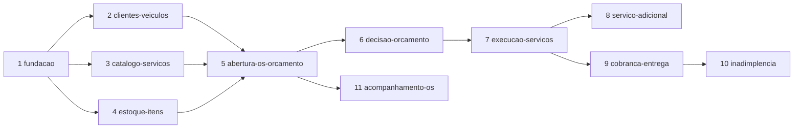

# ROADMAP

Quebra do MVP (fase 1) em escopos implementáveis, derivada de `docs/ddd/event-storming/fluxo-os.md`, `docs/ddd/event-storming/fluxo-pecas-insumos.md`, `docs/ddd/linguagem-ubiqua.md` (Decisões do MVP) e `docs/fase1-tech-challenge.md`.

Cada escopo é uma feature em `.specs/features/<escopo>/spec.md`. Design e tasks são criados quando o escopo começa (auto-sizing do tlc-spec-driven). Decisões transversais ficam em `.specs/STATE.md` (AD-NNN).

## Escopos

| # | Escopo | Contexto | Origem no Event Storming | Depende de | Tamanho |
|---|---|---|---|---|---|
| 1 | [fundacao-plataforma](features/fundacao-plataforma/spec.md) | transversal | Sistemas externos (e-mail), C4 | - | Large |
| 2 | [clientes-veiculos](features/clientes-veiculos/spec.md) | cliente | fluxo-os 3.1; 5.2 (suspensão) | 1 | Medium |
| 3 | [catalogo-servicos](features/catalogo-servicos/spec.md) | ordemservico | ML "Lista de serviços disponíveis" | 1 | Small |
| 4 | [estoque-itens](features/estoque-itens/spec.md) | estoque | fluxo-pecas-insumos fases 1, 3 (5.1, 5.3), 4 (6.3), 5 (7.1) | 1 | Large |
| 5 | [abertura-os-orcamento](features/abertura-os-orcamento/spec.md) | ordemservico | fluxo-os 3.1, 3.2 (passos 6-11); estoque fases 2-3 | 2, 3, 4 | Large |
| 6 | [decisao-orcamento](features/decisao-orcamento/spec.md) | ordemservico | fluxo-os 3.2 (12-13), 3.3, 4.1 (1-2); estoque 6.1, 6.3 | 5 | Large |
| 7 | [execucao-servicos](features/execucao-servicos/spec.md) | ordemservico | fluxo-os 4.1; estoque 7.1 | 6 | Large |
| 8 | [servico-adicional](features/servico-adicional/spec.md) | ordemservico | fluxo-os 4.2 | 7 | Large |
| 9 | [cobranca-entrega](features/cobranca-entrega/spec.md) | cobranca, ordemservico | fluxo-os 5.1 | 7 | Large |
| 10 | [inadimplencia](features/inadimplencia/spec.md) | cobranca, cliente, estoque | fluxo-os 5.2; estoque 7.2 | 9 | Large |
| 11 | [acompanhamento-os](features/acompanhamento-os/spec.md) | ordemservico | Requisitos "Acompanhamento" e "Gestão administrativa" | 5 (cresce com 6-10) | Medium |

Ordem sugerida: 1 → (2, 3, 4 em qualquer ordem) → 5 → 6 → 7 → (8, 9) → 10. O escopo 11 pode começar logo após o 5; cada escopo seguinte acrescenta dados ao detalhamento.

## Validação do Event Storming

Pontos em que os fluxos divergem entre si ou das Decisões do MVP, e como os escopos os resolvem.

| # | Achado | Onde | Resolução |
|---|---|---|---|
| V1 | Estoque reserva itens em "Orçamento aprovado parcialmente"; no fluxo da OS a recusa parcial rejeita o orçamento inicial e abre renegociação, sem reserva. | estoque 6.1/6.3 × fluxo-os 3.3 | Segue o fluxo da OS e a decisão "Reserva só na aprovação". Não existe aprovação parcial com reserva (AD-003). |
| V2 | Estoque pede ao fornecedor quando falta item na aprovação (6.2); a decisão do MVP mantém a OS em Aguardando aprovação e notifica o funcionário. O fluxo da OS não tem esse ramo. | estoque 6.2 × Decisões do MVP | Falta na aprovação: nenhuma reserva, OS continua Aguardando aprovação, funcionário notificado; nova aprovação pode ser registrada após entrada de estoque (escopo 6). |
| V3 | Cotação com fornecedor, item fora de linha, peça defeituosa e garantia aparecem no estoque; fornecedor está fora do MVP. | estoque 5.2, 7.3 | Fora do MVP. Inativar item fica como ação manual do funcionário (escopo 4). |
| V4 | Fluxo de estoque checa estoque mínimo só após o consumo; a linguagem ubíqua exige após consumo **e** descarte. | estoque 7.1 × glossário | Checa após consumo e após descarte (escopo 4). |
| V5 | Descarte de insumo tem o comando "Descartar insumos" duplicado e um passo intermediário "marcar para descarte". | estoque 5.3 | Descarte vira um único comando do funcionário que baixa o saldo físico (escopo 4). Marcação prévia fora do MVP. |
| V6 | "Disponibilidade" na inclusão de itens marca o item como indisponível; a decisão do MVP só bloqueia na aprovação. | estoque 5.1/5.2 × Decisões do MVP | Inclusão aceita e sinaliza indisponibilidade, notificando o funcionário (AD-008). |
| V7 | Atraso aparece por serviço ("Atualiza serviço para em atraso"); o glossário define prazo único da OS, verificado por rotina diária. "Nova data" não tem origem. | fluxo-os 4.1 × glossário | Atraso é da OS, não é status; rotina diária notifica uma vez por prazo; nova data vem de atualização manual do prazo (AD-004, escopo 7). |
| V8 | No cancelamento por inadimplência, o estoque já baixou o saldo na finalização. O fluxo de estoque "atualiza saldo físico" após perda, o que baixaria duas vezes. | estoque 7.2 × glossário "Consumo" | Peças recuperadas entram no saldo físico; não recuperadas só registram perda; insumos não voltam (AD-007, escopo 10). |
| V9 | Serviço adicional: o cliente decide sobre o novo orçamento; aceito precisa reservar os itens novos; rejeitado volta ao orçamento anterior, e Aguardando aprovação → Em execução acontece sem aprovar o orçamento corrente. | fluxo-os 4.2 × Decisões do MVP | Orçamentos versionados no histórico; aceite reserva só o acréscimo; rejeição retoma a versão anterior sem cancelar a OS (AD-006, escopo 8). |
| V10 | "Reorganiza a OS" após recusa parcial é comando do funcionário, mas o fluxo não diz quem remove os componentes recusados. | fluxo-os 3.3 R4 | O sistema remove os componentes recusados e volta a OS para Em diagnóstico; o funcionário ainda pode ajustar antes de reenviar (escopo 6). |
| V11 | "Solicita um serviço" e as decisões são do Cliente, mas o MVP não autentica o cliente. | fluxo-os 3.1/3.2 × requisitos (JWT só admin) | Endpoints `/cliente` sem autenticação simulam a resposta do cliente (AD-001). |
| V12 | Prazo de atraso do pagamento: a política conta da finalização; o diagrama parte de "Cobrança enviada". Dias úteis sem definição de feriados. | fluxo-os 5.2 | Conta a partir da finalização da OS; dias úteis = segunda a sexta, sem feriados (AD-005). |
| V13 | Suspensão do cliente não tem saída. | fluxo-os 5.2 | Reativação manual pelo funcionário (escopo 2). |
| V14 | Cancelamento por orçamento rejeitado não aciona o estoque. | estoque 7.2 | Correto: não há reserva antes da aprovação. Nada a fazer. |

Pendência: registrar em `docs/ddd/linguagem-ubiqua.md` (Decisões do MVP) as resoluções V1, V5, V7, V8, V10 e V11 antes de implementar os escopos que as usam, conforme `AGENTS.md`.

## Entregáveis fora das specs

Não são comportamento de domínio; entram como checklist de release do último escopo.

- [ ] README.md com os itens mínimos de `docs/fase1-tech-challenge.md` (objetivo, arquitetura, execução, testes, Swagger, justificativa do PostgreSQL, credenciais demo, estrutura, links DDD e vídeo).
- [ ] Relatório de análise de vulnerabilidades.
- [ ] Exportar Event Storming e diagramas para PDF em `docs/ddd/`.
- [ ] Evidência de cobertura ≥ 80% (`target/site/jacoco/index.html`).
- [ ] PDF de entrega com branch e hash do commit final.
