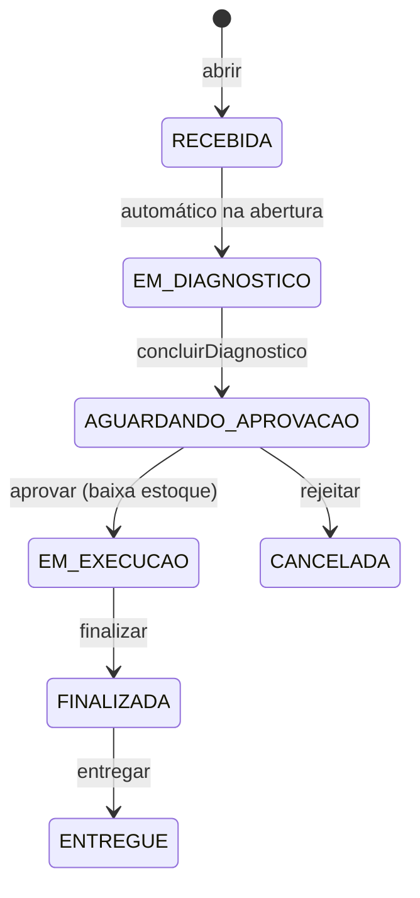
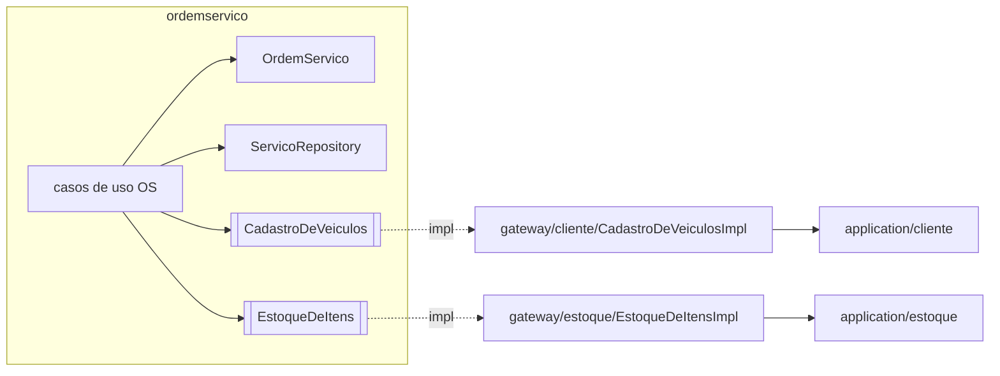

# Ordem de Serviço Design

**Spec**: `.specs/features/abertura-os-orcamento/spec.md`
**Status**: Reviewed

Design do agregado `OrdemServico`, compartilhado pelos escopos `abertura-os-orcamento`, `decisao-orcamento`, `execucao-servicos` e `acompanhamento-os` (que não têm design próprio). Segue os padrões de `.specs/features/fundacao-plataforma/design.md` e as decisões AD-001 a AD-005.

---

## Architecture Overview

Abordagem fixada por `AGENTS.md`: `OrdemServico` é a raiz do agregado e concentra as transições; contextos externos entram por porta do domínio. Nenhuma alternativa de arquitetura muda o escopo.





---

## Code Reuse Analysis

### Existing Components to Leverage

| Component | Location | How to Use |
| --- | --- | --- |
| Padrões, exceções, `Pagina`, `ErroHandler`, `BeanConfig` | `fundacao-plataforma` | Reusar sem alteração |
| `ConsultarClientes`, `ConsultarVeiculos` | `application/cliente` (escopo `clientes-veiculos`) | Chamados por `CadastroDeVeiculosImpl` |
| `ServicoRepository` | `domain/ordemservico` (escopo `catalogo-servicos`) | Mesmo contexto: uso direto |
| `ConsultarItens`, `BaixarItens` | `application/estoque` (escopo `estoque-itens`) | Chamados por `EstoqueDeItensImpl` |

### Integration Points

| System | Integration Method |
| --- | --- |
| Contexto cliente | Porta `CadastroDeVeiculos` |
| Contexto estoque | Porta `EstoqueDeItens` |
| Banco | `V4__ordem_servico.sql`, FKs para `veiculo`, `servico`, `item_estoque` |

---

## Components

### StatusOrdemServico

- **Purpose**: Status e transições permitidas.
- **Location**: `src/main/java/br/com/fiap/oficina/domain/ordemservico/StatusOrdemServico.java`
- **Interfaces**: `enum { RECEBIDA, EM_DIAGNOSTICO, AGUARDANDO_APROVACAO, EM_EXECUCAO, FINALIZADA, ENTREGUE, CANCELADA }`; `boolean podeIrPara(StatusOrdemServico destino)` com a tabela de OS-04.1.

### Orcamento

- **Purpose**: Valor total calculado da OS.
- **Location**: `src/main/java/br/com/fiap/oficina/domain/ordemservico/Orcamento.java`
- **Interfaces**: `static Orcamento calcular(List<ServicoDaOrdem>, List<ItemDaOrdem>)`; `BigDecimal total()` (escala 2, `HALF_EVEN`).

### OrdemServico

- **Purpose**: Raiz do agregado: componentes, orçamento, status e histórico.
- **Location**: `src/main/java/br/com/fiap/oficina/domain/ordemservico/OrdemServico.java`
- **Interfaces**:
  - `static OrdemServico abrir(VeiculoIdentificado veiculo, Instant agora)` → RECEBIDA → EM_DIAGNOSTICO
  - `incluirServico(Servico)`, `removerServico(Long servicoId)`, `incluirItem(ItemCotado, int quantidade)`, `removerItem(Long itemId)` — só EM_DIAGNOSTICO
  - `concluirDiagnostico(Instant agora)` — exige ao menos um serviço; calcula `Orcamento`
  - `aprovar(Instant)`, `rejeitar(Instant)`, `finalizar(Instant)`, `entregar(Instant)` (escopos 6 e 7)
  - `Optional<Duration> tempoDeExecucao()` (escopo 8)
  - `private mudarPara(StatusOrdemServico, Instant)` valida `podeIrPara` e registra `MudancaDeStatus`
- **Value objects** (mesmo pacote, `record`): `ServicoDaOrdem(servicoId, nome, valor)`, `ItemDaOrdem(itemId, sku, nome, quantidade, precoUnitario)`, `MudancaDeStatus(status, dataHora)`.

### Portas

- **Location**: `src/main/java/br/com/fiap/oficina/domain/ordemservico/`
- **Interfaces**:
  - `CadastroDeVeiculos.identificar(String cpfCnpj, String placa): VeiculoIdentificado(veiculoId, cpfCnpj, placa)` — lança 422 (formato, dono diferente) ou 404
  - `CadastroDeVeiculos.normalizarCpfCnpj(String cpfCnpj): String` (escopo 8)
  - `EstoqueDeItens.cotar(Long itemId): ItemCotado(itemId, sku, nome, precoVenda)` — 422 se não existe
  - `EstoqueDeItens.baixar(List<ItemDaOrdem>)` — lança `DomainException` com `detalhes` dos faltantes (escopo 6)
  - `OrdemServicoRepository`: `salvar`, `buscarPorId`, `listar(pagina, tamanho)`, `listarFinalizadas()` (os dois últimos no escopo 8)

### Casos de uso (`application/ordemservico`)

| Caso de uso | Escopo | Requisito |
| --- | --- | --- |
| `AbrirOrdemServico` | 5 | OS-01 |
| `IncluirServicoNaOrdem`, `RemoverServicoDaOrdem` | 5 | OS-02 |
| `IncluirItemNaOrdem`, `RemoverItemDaOrdem` | 5 | OS-02 |
| `ConcluirDiagnostico` | 5 | OS-03 |
| `AprovarOrcamento`, `RejeitarOrcamento` | 6 | ORC-01, ORC-02 |
| `FinalizarOrdemServico`, `EntregarVeiculo` | 7 | EXE-01, EXE-02 |
| `ConsultarAndamento`, `ListarOrdensServico`, `DetalharOrdemServico`, `CalcularTempoMedioExecucao` | 8 | ACO-01..03 |

Saída comum: `OrdemServicoDTO(id, cpfCnpj, placa, status, servicos, itens, total, historico)`.

### Endpoints

| Método e caminho | Auth | Caso de uso |
| --- | --- | --- |
| `POST /ordens-servico` | JWT | AbrirOrdemServico |
| `POST /ordens-servico/{id}/servicos` · `DELETE /ordens-servico/{id}/servicos/{servicoId}` | JWT | Incluir/RemoverServicoNaOrdem |
| `POST /ordens-servico/{id}/itens` · `DELETE /ordens-servico/{id}/itens/{itemId}` | JWT | Incluir/RemoverItemNaOrdem |
| `POST /ordens-servico/{id}/orcamento` | JWT | ConcluirDiagnostico |
| `POST /ordens-servico/{id}/finalizacao` · `POST /ordens-servico/{id}/entrega` | JWT | Finalizar / Entregar |
| `GET /ordens-servico` · `GET /ordens-servico/{id}` · `GET /ordens-servico/tempo-medio-execucao` | JWT | Listar / Detalhar / Tempo médio |
| `POST /cliente/ordens-servico/{id}/aprovacao` · `.../rejeicao` | público (AD-001) | Aprovar / Rejeitar |
| `GET /cliente/ordens-servico/{id}?cpfCnpj=` | público (AD-001) | ConsultarAndamento |

---

## Data Models

```sql
-- V4__ordem_servico.sql
ordem_servico(id bigserial pk, veiculo_id bigint not null fk veiculo, cpf_cnpj varchar(14) not null,
              placa varchar(7) not null, status varchar(30) not null, total numeric(12,2), aberta_em timestamptz not null)
ordem_servico_servico(ordem_servico_id fk, servico_id fk servico, nome varchar not null, valor numeric(12,2) not null,
                      pk(ordem_servico_id, servico_id))
ordem_servico_item(ordem_servico_id fk, item_id fk item_estoque, sku varchar not null, nome varchar not null,
                   quantidade int not null check (quantidade > 0), preco_unitario numeric(12,2) not null,
                   pk(ordem_servico_id, item_id))
ordem_servico_historico(id bigserial pk, ordem_servico_id fk, status varchar(30) not null, data_hora timestamptz not null)
```

**Relationships**: OS N:1 veículo; componentes copiam nome e preço no momento da inclusão; histórico ordenado por `data_hora`.

---

## Error Handling Strategy

| Error Scenario | Handling | User Impact |
| --- | --- | --- |
| CPF/CNPJ ou placa inválidos na abertura | Porta repassa `DomainException` do contexto cliente | 422 |
| Cliente/veículo/serviço/OS inexistente | `NaoEncontradoException` | 404 (serviço/item inexistente na inclusão: 422, OS-02.4) |
| Comando fora do status permitido | `OrdemServico` lança `DomainException` | 422 |
| Serviço já incluído na OS | `DomainException` | 422 |
| Falta de estoque na aprovação | `DomainException` com `detalhes` (sku, pedida, saldo); transação desfeita | 422 com itens faltantes |
| OS de outro titular na consulta do cliente | `NaoEncontradoException` com a mesma mensagem de OS inexistente | 404 |

---

## Risks & Concerns

| Concern | Location (file:line) | Impact | Mitigation |
| --- | --- | --- | --- |
| Tempo médio carrega todas as OS finalizadas em memória | `CalcularTempoMedioExecucao` | Lento com muitas OS | Comentário `ponytail:` com teto; trocar por `avg` em SQL quando o volume justificar |
| Aprovações simultâneas disputando o último item | `EstoqueDeItensImpl.baixar` | Saldo negativo | `@Version` em `ItemEstoqueEntity` + `CHECK (saldo_fisico >= 0)`; conflito vira 409 |
| `/cliente/**` sem autenticação permite registrar decisão de qualquer OS | `SecurityConfig` | Decisão forjada | Aceito em AD-001; consulta exige CPF/CNPJ do titular |

---

## Tech Decisions (only non-obvious ones)

| Decision | Choice | Rationale |
| --- | --- | --- |
| Dados do cliente na OS | OS guarda `veiculo_id` (FK) e cópia de `cpf_cnpj` e `placa` | Identificadores imutáveis (spec CLI); listagem e consulta do cliente sem chamar outro contexto |
| Serviço repetido na OS | Rejeitado com 422 | Remoção por `servicoId` fica inequívoca |
| Ordem na aprovação | `baixar` antes de `aprovar` | Falha de estoque não muda o agregado nem em teste sem transação |
| FKs entre tabelas de contextos diferentes | Permitidas no banco | Um único banco; garante 409 na remoção de cadastro em uso |
