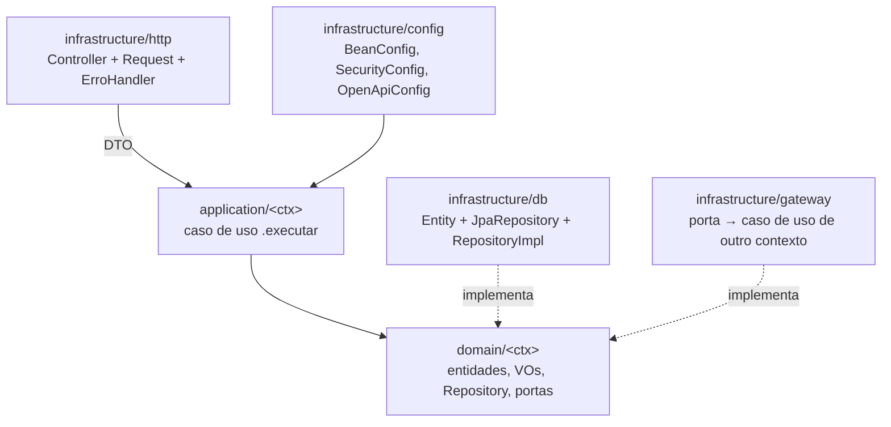

# Fundação da Plataforma Design

**Spec**: `.specs/features/fundacao-plataforma/spec.md`
**Status**: Draft

Este design fixa os padrões que todos os escopos seguem. Escopos CRUD (`clientes-veiculos`, `catalogo-servicos`, `estoque-itens`) não têm design próprio: aplicam este documento. O agregado da OS está em `.specs/features/abertura-os-orcamento/design.md`.

---

## Architecture Overview

Arquitetura fixada por `AGENTS.md`: monolito modular, `infrastructure` → `application` → `domain`, contextos por subpacote. Não há abordagens alternativas a escolher.

Fluxo de uma requisição: `Controller` (`@Transactional`, `@Valid`) → converte request em DTO → `CasoDeUso.executar(dto)` → domínio valida e muda estado → `Repository` persiste → controller devolve o DTO de saída.

---

## Code Reuse Analysis

### Existing Components to Leverage

| Component | Location | How to Use |
| --- | --- | --- |
| Dependências já declaradas | `pom.xml` | webmvc, validation, data-jpa, flyway, postgresql, oauth2-resource-server (Nimbus), springdoc, testcontainers, archunit, jacoco. Nenhuma dependência nova |
| Gate de cobertura | `pom.xml:115-158` | Regra JaCoCo 80% em `domain.*` e `application.*` já declarada; só precisa ser comprovada (Risks) |
| Separação unitário/integração | `pom.xml:111-114` | Failsafe roda `*IT` em `verify` |
| Pacotes por camada/contexto | `src/main/java/br/com/fiap/oficina/**/.gitkeep` | Criar classes nos pacotes existentes e remover o `.gitkeep` do pacote que ganhar classe |

### Integration Points

| System | Integration Method |
| --- | --- |
| PostgreSQL | Flyway em `src/main/resources/db/migration`, `spring.jpa.hibernate.ddl-auto=validate` |
| Testes de integração | `@ServiceConnection` + `PostgreSQLContainer` em uma `@TestConfiguration` única importada pelos `*IT` |

---

## Components

### OficinaApplication e configuração

- **Purpose**: Ponto de entrada e propriedades da aplicação.
- **Location**: `src/main/java/br/com/fiap/oficina/OficinaApplication.java`, `src/main/resources/application.yml`
- **Interfaces**: propriedades `spring.datasource.*` via variáveis `DB_URL`, `DB_USER`, `DB_PASSWORD`; `oficina.jwt.segredo` via `JWT_SEGREDO`; `oficina.usuario.nome` / `oficina.usuario.senha-hash`.
- **Dependencies**: PostgreSQL.
- **Reuses**: autoconfiguração do Spring Boot.

### TestcontainersConfig

- **Purpose**: Um PostgreSQL de teste compartilhado pelos `*IT`.
- **Location**: `src/test/java/br/com/fiap/oficina/infrastructure/TestcontainersConfig.java`
- **Interfaces**: `@Bean @ServiceConnection PostgreSQLContainer postgres()`.
- **Dependencies**: Docker em execução.
- **Reuses**: `spring-boot-testcontainers`.

### Exceções de domínio

- **Purpose**: Sinalizar violação de regra (422), recurso inexistente (404) e conflito (409) sem Spring.
- **Location**: `src/main/java/br/com/fiap/oficina/domain/DomainException.java`, `NaoEncontradoException.java`, `ConflitoException.java`
- **Interfaces**:
  - `DomainException(String codigo, String mensagem)` e `DomainException(String codigo, String mensagem, List<?> detalhes)`
  - `NaoEncontradoException extends DomainException`
  - `ConflitoException extends DomainException`
- **Dependencies**: nenhuma.
- **Reuses**: -

### Pagina

- **Purpose**: Resultado paginado devolvido pelos repositórios, sem Spring Data no domínio.
- **Location**: `src/main/java/br/com/fiap/oficina/domain/Pagina.java`
- **Interfaces**: `record Pagina<T>(List<T> itens, int pagina, int tamanho, long total)` com `map(Function)`.
- **Dependencies**: nenhuma.
- **Reuses**: - (criado no primeiro repositório que lista: `clientes-veiculos`)

### ErroHandler

- **Purpose**: Contrato único de erro.
- **Location**: `src/main/java/br/com/fiap/oficina/infrastructure/http/ErroHandler.java`
- **Interfaces**: `record ErroResponse(String codigo, String mensagem, List<CampoInvalido> campos, List<?> detalhes)`.

| Exceção | HTTP |
| --- | --- |
| `MethodArgumentNotValidException` | 400 (`campos`) |
| `NaoEncontradoException` | 404 |
| `ConflitoException`, `DataIntegrityViolationException`, `ObjectOptimisticLockingFailureException` | 409 |
| `DomainException` | 422 (`detalhes` quando houver) |
| `Exception` | 500, mensagem genérica |

### SecurityConfig

- **Purpose**: JWT HS256 stateless nas APIs administrativas.
- **Location**: `src/main/java/br/com/fiap/oficina/infrastructure/config/SecurityConfig.java`
- **Interfaces**:
  - `SecurityFilterChain`: CSRF desligado, sessão `STATELESS`; `permitAll` em `POST /autenticacao`, `/cliente/**`, `/v3/api-docs/**`, `/swagger-ui/**`, `/swagger-ui.html`; demais `authenticated()`; `oauth2ResourceServer(jwt)`; entry point 401.
  - `JwtDecoder` = `NimbusJwtDecoder.withSecretKey(chave).build()`; `JwtEncoder` = `NimbusJwtEncoder(new ImmutableSecret<>(chave))`; chave HmacSHA256 de `oficina.jwt.segredo` (≥ 32 bytes).
  - `UserDetailsService` = `InMemoryUserDetailsManager` com o usuário de `oficina.usuario.*`; `PasswordEncoder` = `PasswordEncoderFactories.createDelegatingPasswordEncoder()`.
- **Dependencies**: `spring-boot-starter-security-oauth2-resource-server`.
- **Reuses**: Spring Security (Context7 `/spring-projects/spring-security/7.1.1`: `NimbusJwtDecoder.withSecretKey`).

### AutenticacaoController

- **Purpose**: Emitir JWT para o funcionário.
- **Location**: `src/main/java/br/com/fiap/oficina/infrastructure/http/autenticacao/AutenticacaoController.java`
- **Interfaces**: `POST /autenticacao {usuario, senha}` → `200 {token, expiraEm}`; credencial inválida → 401.
- **Dependencies**: `AuthenticationManager` (DaoAuthenticationProvider), `JwtEncoder`, `Clock`.
- **Reuses**: SecurityConfig.

### OpenApiConfig

- **Purpose**: Declarar esquema Bearer no OpenAPI.
- **Location**: `src/main/java/br/com/fiap/oficina/infrastructure/config/OpenApiConfig.java`
- **Interfaces**: `@SecurityScheme(name = "bearer", type = HTTP, scheme = "bearer", bearerFormat = "JWT")`; controllers administrativos anotados com `@SecurityRequirement(name = "bearer")`.
- **Dependencies**: springdoc.

### BeanConfig

- **Purpose**: Registrar casos de uso e `Clock` como beans (application sem Spring).
- **Location**: `src/main/java/br/com/fiap/oficina/infrastructure/config/BeanConfig.java`
- **Interfaces**: um `@Bean` por caso de uso; `@Bean Clock clock()` = `Clock.systemDefaultZone()`.
- **Reuses**: - (cada escopo acrescenta seus beans na task do seu controller)

---

## Padrões para todos os escopos

| Tema | Padrão |
| --- | --- |
| Caso de uso | Classe por verbo (`CadastrarCliente`), construtor recebe repositórios/portas/`Clock`, método `executar(DTO)` devolve DTO |
| DTO | `record` em `application/<ctx>`: entrada `<Verbo><Conceito>DTO`, saída `<Conceito>DTO` |
| Request | `record` com Bean Validation em `infrastructure/http/<ctx>`, convertido para DTO no controller |
| Transação | `@Transactional` no método do controller |
| Persistência | `<X>Entity` + `<X>JpaRepository` (Spring Data) + `<X>RepositoryImpl implements <X>Repository` convertendo modelo ↔ entity, em `infrastructure/db/<ctx>` |
| Unicidade | Caso de uso verifica e lança `ConflitoException`; constraint `UNIQUE` no banco cobre concorrência |
| Remoção de recurso em uso | FK no banco; violação vira 409 no `ErroHandler` |
| Migrations | `V1__cliente_veiculo.sql`, `V2__servico.sql`, `V3__item_estoque.sql`, `V4__ordem_servico.sql`; escopos 2 → 3 → 4 nessa ordem |
| Dinheiro | `BigDecimal`, `numeric(12,2)` |
| Testes unitários | `domain`/`application`, `*Test`, repositórios em memória como classes de teste (`ClienteRepositoryEmMemoria`) |
| Testes de integração | `*IT` em `infrastructure`, `@SpringBootTest(webEnvironment = RANDOM_PORT)` + `@Import(TestcontainersConfig.class)`, JWT obtido via `POST /autenticacao` ou `SecurityMockMvcRequestPostProcessors.jwt()` |

---

## Error Handling Strategy

| Error Scenario | Handling | User Impact |
| --- | --- | --- |
| Request inválido | `@Valid` → 400 | Lista de campos inválidos |
| Regra de negócio | `DomainException` → 422 | `codigo` + `mensagem` (+ `detalhes`) |
| Duplicidade / recurso em uso / edição concorrente | 409 | Mensagem de conflito |
| Token ausente/inválido | Entry point → 401 | Corpo vazio ou `ErroResponse` 401 |
| Erro inesperado | 500 genérico, log com stack trace | Sem detalhes internos |

---

## Risks & Concerns

| Concern | Location (file:line) | Impact | Mitigation |
| --- | --- | --- | --- |
| Padrão `br.com.fiap.oficina.domain.*` no elemento `PACKAGE` pode não casar com o nome do pacote usado pelo JaCoCo, deixando o gate inativo | `pom.xml:139-142` | Cobertura abaixo de 80% passa sem falhar | Task FUND T5 prova o gate com pacote sem teste; ajusta o padrão se não falhar |
| `failsafe` declarado sem `<executions>`; depende do `pluginManagement` do parent rodar `integration-test`/`verify` | `pom.xml:111-114` | `*IT` não rodam em `verify` | Task FUND T1 confirma que `OficinaApplicationIT` roda em `./mvnw verify` |
| ArchUnit falha por padrão quando a regra não encontra classes (pacotes vazios no início) | `src/test/java/.../ArquiteturaTest.java` | Build quebra antes de existir código | Regras com `.allowEmptyShould(true)` |
| Segredo JWT e hash de senha com default no `application.yml` | `src/main/resources/application.yml` | Segredo de demo vazaria para produção | Default só para execução local, sobrescrito por `JWT_SEGREDO`; README documenta |
| Testes de integração exigem Docker | `TestcontainersConfig` | `verify` falha sem Docker | Já previsto em `AGENTS.md`; README registra pré-requisito |

---

## Tech Decisions (only non-obvious ones)

| Decision | Choice | Rationale |
| --- | --- | --- |
| Usuário de demonstração | `InMemoryUserDetailsManager` lido de propriedades (hash BCrypt) | Sem tabela, entity ou migration para um único usuário |
| 404 e 409 sem Spring no domínio | `NaoEncontradoException` e `ConflitoException` estendendo `DomainException` | Status HTTP decidido só no `ErroHandler` |
| Concorrência de escrita | Constraint no banco + `@Version` onde há disputa (saldo de estoque) | Garante a regra mesmo com requisições simultâneas |
