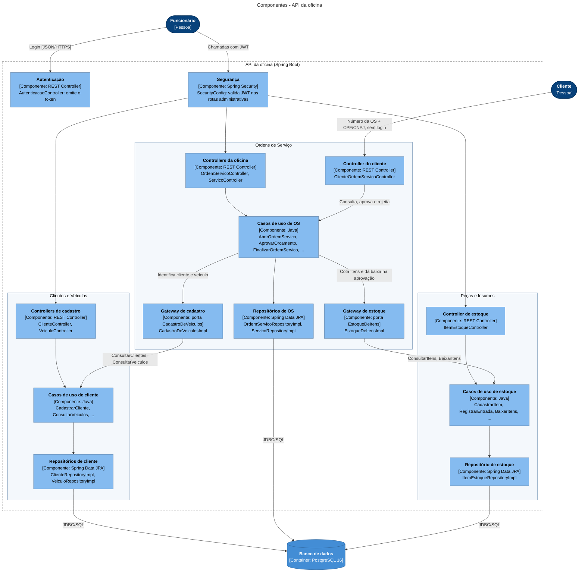

# Modelo C4 — Componentes da API

A API é um monólito modular: cada contexto tem seus controllers, casos de uso e repositórios, e o contexto de Ordens de Serviço só acessa os outros dois por portas declaradas no próprio domínio (`CadastroDeVeiculos` e `EstoqueDeItens`). Essas regras de dependência são verificadas pelo [`ArquiteturaTest`](../../../src/test/java/br/com/fiap/oficina/ArquiteturaTest.java).

## Como ler

- **Camadas:** controllers (`infrastructure/http`) chamam casos de uso (`application`), que aplicam as regras do domínio (`domain`) e persistem pelos repositórios (`infrastructure/db`). `application` e `domain` não dependem de Spring.
- **Transação:** abre no controller, então aprovar o orçamento e dar baixa nos itens acontecem juntos ou não acontecem.
- **Entre contextos:** a OS não conhece as classes de cliente nem de estoque. Ela declara as portas `CadastroDeVeiculos` e `EstoqueDeItens` no domínio, e os gateways em `infrastructure/gateway` as implementam chamando os casos de uso do outro contexto.
- **Erros:** o `ErroHandler` (omitido no diagrama) converte as exceções de todas as camadas no formato padrão de erro da API.
- **Cobrança e Faturamento:** contexto reservado, sem implementação no MVP.
