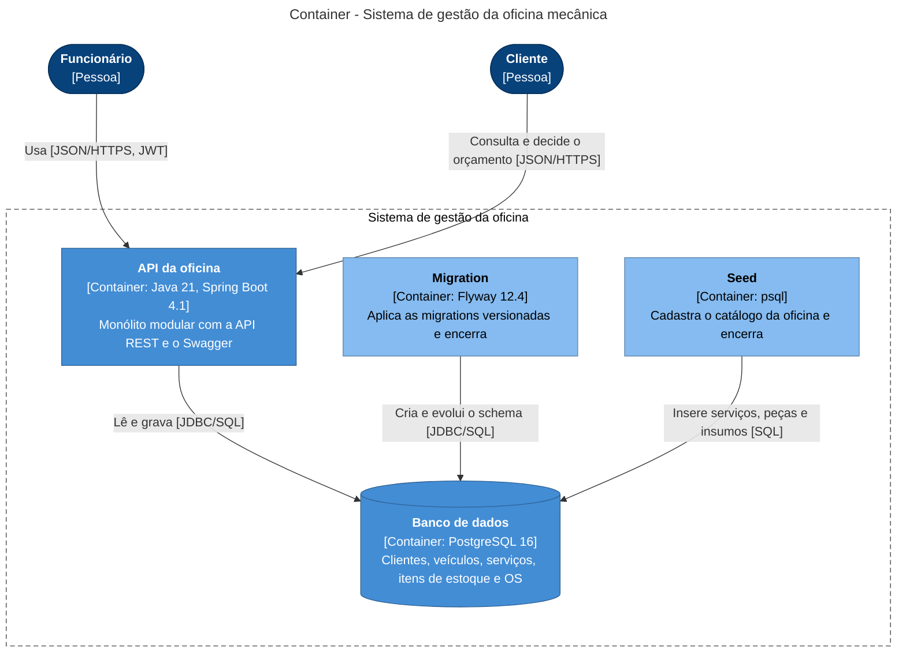

# Modelo C4 — Container

O sistema roda como um monólito Spring Boot sobre um PostgreSQL. O schema e o catálogo inicial são preparados por dois containers de execução única, antes da API subir (ver [`docker-compose.yml`](../../../docker-compose.yml)).

Ordem de subida: `postgres` → `migration` → `seed` → `api`. Cada etapa só começa quando a anterior termina com sucesso. Fora do Docker, a própria API aplica as migrations ao iniciar.
