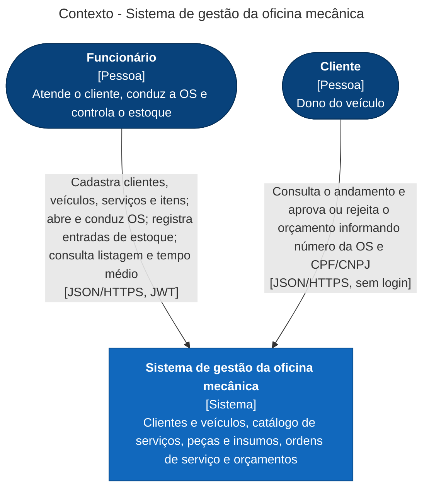

# Modelo C4 — Contexto

O sistema de gestão da oficina é um único sistema, usado pelo funcionário com login (JWT) e pelo cliente sem login, que se identifica com o número da OS e o CPF/CNPJ do titular. No MVP ele não se integra com nenhum sistema externo.

## Fora do MVP

O Event Storming e o board do Figma também mapeiam sistemas externos que não foram implementados: provedor de e-mail, sistema de pagamentos, emissão de nota fiscal e fornecedor de itens. O motivo de cada corte está em [`.specs/ROADMAP.md`](../../../.specs/ROADMAP.md) (AD-003).
