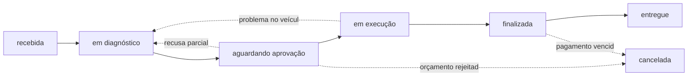
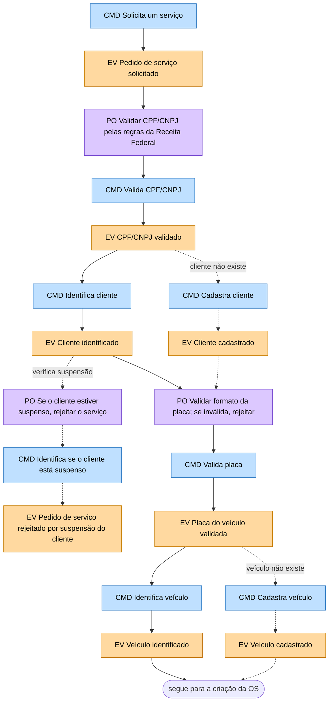
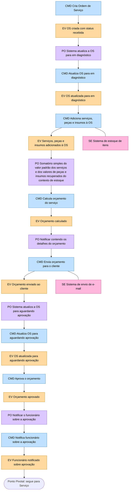
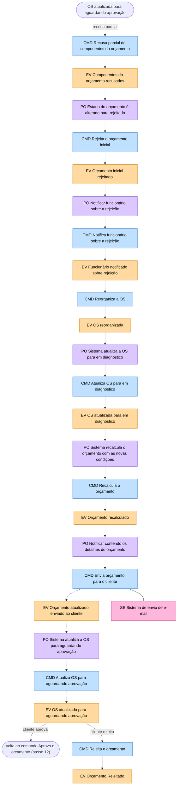
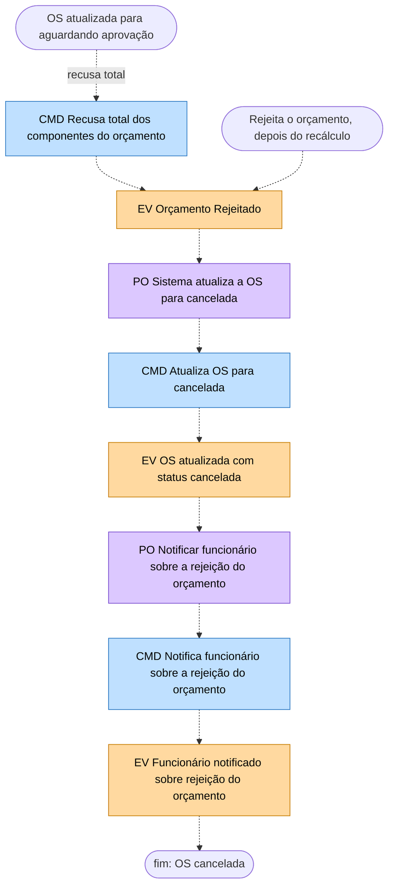
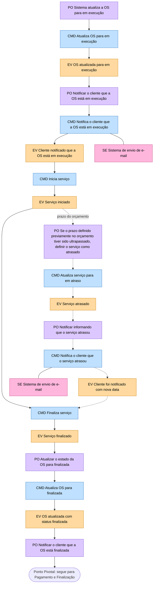
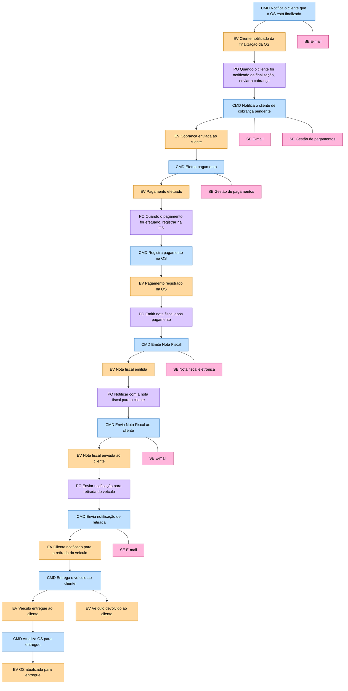
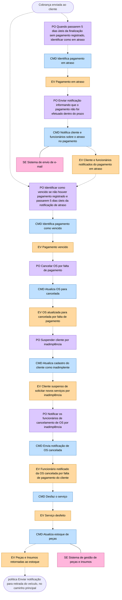
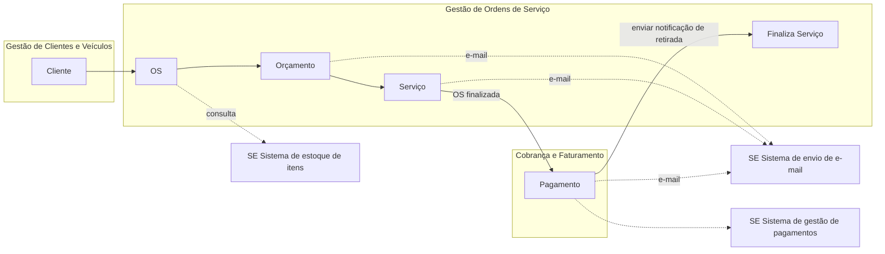

# Fluxo de Ordem de Serviço (OS): descrição completa do Event Storming

Os diagramas estão em Mermaid e descem de cima para baixo; as setas tracejadas são os desvios. As tabelas repetem o mesmo conteúdo em texto, passo a passo.

Nos diagramas Mermaid deste documento: caixa **azul** = comando (CMD), **laranja** = evento (EV), **roxa** = política (PO), **rosa** = sistema externo (SE). Linha **contínua** = caminho principal; linha **tracejada** = exceção. Atores e modelos de leitura não aparecem nos diagramas e estão nas tabelas.

## 1. Atores, modelos de leitura e sistemas externos

**Atores:** Cliente (solicita o serviço, aprova ou recusa o orçamento, paga) e Funcionário (identifica e cadastra cliente e veículo, cria e atualiza a OS, executa o serviço, entrega o veículo).

**Sistemas externos (SE):**

| Sistema | Onde é usado |
|---|---|
| Receita Federal | Regra de validação de CPF/CNPJ (aparece só no texto de uma política) |
| Sistema de estoque de itens | Consulta ao adicionar peças e insumos à OS |
| Sistema de gestão de peças e insumos | Devolução de peças ao estoque no cancelamento por inadimplência |
| Sistema de envio de e-mail (Provedor) | Todas as notificações ao cliente |
| Sistema de gestão de pagamentos | Cobrança e pagamento |
| Sistema de nota fiscal eletrônica | Emissão da nota fiscal |

**Modelos de leitura (ML) usados:** Lista de serviços disponíveis oferecidos pela oficina; Lista de clientes cadastrados; Lista de veículos cadastrados; Lista de serviços com peças e insumos necessários; Lista dos componentes do orçamento da OS; Lista dos serviços da OS; Lista dos serviços disponíveis; Detalhamento do orçamento e instruções para pagamento.

## 2. Ciclo de vida da OS

A OS nasce "recebida" e passa logo para "em diagnóstico". O orçamento a leva para "aguardando aprovação". Aprovado, ela vai para "em execução", depois "finalizada" e, após pagamento e retirada, "entregue". Ela volta a "em diagnóstico" em duas situações (recusa parcial do orçamento e problema encontrado no veículo durante o serviço) e termina "cancelada" quando o orçamento é rejeitado ou o pagamento vence.

## 3. Fase 1: Criação da OS

A fase vai do pedido do cliente até a aprovação do orçamento e termina no primeiro Ponto Pivotal. Ela tem três partes: identificação do cliente e do veículo, diagnóstico e orçamento, e o tratamento da recusa do orçamento.

### 3.1 Identificação do cliente e do veículo

| # | Ator e modelo de leitura | Comando | Evento | Política associada |
|---|---|---|---|---|
| 1 | Cliente. ML: Lista de serviços disponíveis oferecidos pela oficina | Solicita um serviço | Pedido de serviço solicitado | Validar o CPF/CNPJ de acordo com as regras da Receita Federal (fica entre este evento e o próximo comando) |
| 2 | n/a | Valida CPF/CNPJ | CPF/CNPJ validado | n/a |
| 3 | Funcionário. ML: Lista de clientes cadastrados | Identifica cliente | Cliente identificado | n/a |
| 4 | n/a | Valida placa | Placa do veículo validada | Validar o formato da placa; se inválida, rejeitar (antecede o comando; recebe setas de "Cliente identificado" e de "Cliente cadastrado") |
| 5 | Funcionário. ML: Lista de veículos cadastrados | Identifica veículo | Veículo identificado | n/a |

**Desvios desta parte (tracejados):**

| Desvio | Sai de | Sequência | Para onde vai |
|---|---|---|---|
| Cliente não cadastrado | CPF/CNPJ validado | Funcionário (ML Lista de clientes cadastrados): Cadastra cliente, evento Cliente cadastrado | Política de validação da placa (passo 4) |
| Cliente suspenso | Cliente identificado | Política "Identificar se o cliente está suspenso, caso esteja rejeitar o serviço", comando Identifica se o cliente está suspenso, evento Pedido de serviço rejeitado por suspensão do cliente | Fim (o pedido é rejeitado) |
| Veículo não cadastrado | Placa do veículo validada | Funcionário (ML Lista de veículos cadastrados): Cadastra veículo, evento Veículo cadastrado | Comando Cria Ordem de Serviço (passo 6) |

### 3.2 Diagnóstico e orçamento até a aprovação

| # | Ator e modelo de leitura | Comando | Evento | Política associada | Sistema externo |
|---|---|---|---|---|---|
| 6 | Funcionário | Cria Ordem de Serviço | Ordem de serviço criada com status "recebida" | Depois do evento: O Sistema atualiza a OS para "em diagnóstico" | n/a |
| 7 | n/a | Atualiza OS para "em diagnóstico" | Ordem de serviço atualizada para o status "em diagnóstico" | n/a | n/a |
| 8 | Funcionário. ML: Lista de serviços com peças e insumos necessários | Adiciona serviços, peças e insumos à OS | Serviços, peças e insumos adicionados à OS | n/a | Sistema de estoque de itens |
| 9 | n/a | Calcula orçamento do serviço | Orçamento calculado | Antes do comando: somatório simples do valor padrão dos serviços e dos valores de peças e insumos recuperados do contexto de estoque | n/a |
| 10 | n/a | Envia orçamento para o cliente | Orçamento enviado ao cliente | Antes: notificar contendo os detalhes do orçamento. Depois: O Sistema atualiza a OS para "aguardando aprovação" | Sistema de envio de e-mail |
| 11 | n/a | Atualiza OS para "aguardando aprovação" | OS atualizada para o status "aguardando aprovação" | n/a | n/a |
| 12 | Cliente. ML: Lista dos componentes do orçamento da OS | Aprova o orçamento | Orçamento aprovado | Notificar o funcionário sobre a aprovação do orçamento | n/a |
| 13 | n/a | Notifica funcionário sobre a aprovação do orçamento | Funcionário notificado sobre aprovação do orçamento | n/a | n/a |

Depois do passo 13, uma linha contínua atravessa o primeiro Ponto Pivotal e inicia a fase Serviço.

### 3.3 Exceção: recusa do orçamento

Depois de **"OS atualizada para aguardando aprovação"** (passo 11), o cliente tem três saídas: aprovar (passo 12, linha contínua), **recusar parcialmente** os componentes ou **recusar totalmente** (as duas, tracejadas). A recusa parcial reabre o diagnóstico, recalcula o orçamento e o envia de novo; **nesse segundo envio o cliente só pode aprovar ou rejeitar**, de modo que a renegociação acontece uma única vez.

**Recusa parcial (volta ao diagnóstico):**

| # | Ator e modelo de leitura | Comando | Evento | Política associada |
|---|---|---|---|---|
| R1 | Cliente. ML: Lista dos componentes do orçamento da OS | Recusa parcial de componentes do orçamento | Componentes do orçamento recusados | Estado do orçamento é alterado para rejeitado |
| R2 | n/a | Rejeita o orçamento inicial | Orçamento inicial rejeitado | Notificar o funcionário sobre a rejeição do orçamento |
| R3 | n/a | Notifica funcionário sobre a rejeição do orçamento | Funcionário notificado sobre rejeição do orçamento | n/a |
| R4 | Funcionário. ML: Lista dos componentes do orçamento da OS | Reorganiza a OS | OS reorganizada | O Sistema atualiza a OS para "em diagnóstico" |
| R5 | n/a | Atualiza OS para "em diagnóstico" | Ordem de serviço atualizada para o status "em diagnóstico" | O Sistema recalcula o orçamento da OS baseado nas novas condições |
| R6 | n/a | Recalcula o orçamento | Orçamento recalculado | Notificar contendo os detalhes do orçamento |
| R7 | n/a | Envia orçamento para o cliente (SE e-mail) | Orçamento atualizado enviado ao cliente | O Sistema atualiza a OS para "aguardando aprovação" |
| R8 | n/a | Atualiza OS para "aguardando aprovação" | OS atualizada para o status "aguardando aprovação" | n/a |

Do evento R8 o cliente pode **aprovar** (seta tracejada de volta ao comando "Aprova o orçamento", e a partir daí o fluxo principal segue) ou **rejeitar**.

**Rejeição e cancelamento:**

| # | Ator e modelo de leitura | Comando | Evento | Política associada |
|---|---|---|---|---|
| J1a | Cliente. ML: Lista dos componentes do orçamento da OS | Recusa total dos componentes do orçamento (vem do passo 11) | Orçamento Rejeitado | O Sistema atualiza a OS para "cancelada" |
| J1b | Cliente. ML: Lista dos componentes do orçamento da OS | Rejeita o orçamento (vem do evento R8) | Orçamento Rejeitado | (mesmo evento de J1a) |
| J2 | n/a | Atualiza OS para "cancelada" | OS atualizada com status "cancelada" | Notificar o funcionário sobre a rejeição do orçamento |
| J3 | n/a | Notifica funcionário sobre a rejeição do orçamento | Funcionário notificado sobre rejeição do orçamento | Fim do fluxo |

## 4. Fase 2: Serviço

A fase começa logo depois do primeiro Ponto Pivotal, com a OS passando para "em execução", e termina quando a OS é finalizada e o cliente é avisado.

### 4.1 Caminho principal e serviço atrasado

| # | Ator e modelo de leitura | Comando | Evento | Política associada | Sistema externo |
|---|---|---|---|---|---|
| 1 | n/a | Atualiza OS para "em execução" | OS atualizada para o status "em execução" | Antes: O Sistema atualiza a OS para "em execução" (logo após o Ponto Pivotal). Depois: Notificar o cliente que a OS está em execução | n/a |
| 2 | n/a | Notifica o cliente que a OS está em execução | Cliente notificado que a OS está em execução | n/a | Sistema de envio de e-mail |
| 3 | Funcionário. ML: Lista dos serviços da OS | Inicia serviço | Serviço iniciado | n/a | n/a |
| 4 | Funcionário. ML: Lista dos serviços da OS | Finaliza serviço | Serviço finalizado | Atualizar o estado da OS para "finalizada" | n/a |
| 5 | n/a | Atualiza OS para "finalizada" | OS atualizada com status de "finalizada" | Notificar o cliente que a OS está finalizada | n/a |

**Desvio: serviço atrasado.** A partir de *Serviço iniciado* uma trilha tracejada mostra: política de prazo ("Se o prazo definido previamente no orçamento tiver sido ultrapassado definir o serviço como atrasado"), comando *Atualiza serviço para em atraso*, evento *Serviço atrasado*, política *Notificar informando que o serviço atrasou*, comando *Notifica o cliente que o serviço atrasou* (SE e-mail) e evento *Cliente foi notificado com nova data*. A trilha volta ao comando *Finaliza serviço* (passo 4).

### 4.2 Desvio: problema no veículo e serviço adicional

A partir de *Serviço iniciado* outra trilha tracejada trata o caso em que o funcionário encontra um problema no veículo. A OS volta ao diagnóstico, o orçamento é recalculado e o cliente decide sobre o **novo orçamento**: aceitar (o serviço é retomado) ou rejeitar (volta-se ao orçamento anterior e o serviço também é retomado).

```mermaid
flowchart TD
  classDef cmd fill:#bfe0ff,stroke:#2b78c2,color:#000
  classDef ev fill:#ffd9a0,stroke:#c77d00,color:#000
  classDef po fill:#dcc8ff,stroke:#7b4fd1,color:#000
  classDef se fill:#ffb6dc,stroke:#c2417c,color:#000
  I(["Serviço iniciado"]) -.-> V1["CMD Identifica problema no veículo"]:::cmd -.-> V2["EV Problema no veículo identificado"]:::ev -.-> V3["CMD Funcionário adiciona um serviço adicional"]:::cmd -.-> V4["EV Serviço adicional adicionado"]:::ev
  V4 -.-> V5["PO Sistema atualiza a OS para em diagnóstico"]:::po -.-> V6["CMD Atualiza a OS para em diagnóstico"]:::cmd -.-> V7["EV OS atualizada para em diagnóstico"]:::ev
  V7 -.-> V8["PO Sistema recalcula o orçamento com as novas condições"]:::po -.-> V9["CMD Recalcula o orçamento"]:::cmd -.-> V10["EV Orçamento recalculado"]:::ev
  V10 -.-> V11["PO Notificar contendo os detalhes do orçamento"]:::po -.-> V12["CMD Envia um novo orçamento ao cliente"]:::cmd -.-> V13["EV Novo orçamento enviado ao cliente"]:::ev
  V12 --- V12S["SE Sistema de envio de e-mail"]:::se
  V13 -.-> V14["PO Sistema atualiza a OS para aguardando aprovação"]:::po -.-> V15["CMD Atualiza OS para aguardando aprovação"]:::cmd -.-> V16["EV OS atualizada para aguardando aprovação"]:::ev
  V16 -.->|cliente aceita| V17["CMD Aceita o orçamento"]:::cmd -.-> V18["EV Novo orçamento aceito"]:::ev -.-> V19["PO Notificar o funcionário sobre o orçamento"]:::po
  V16 -.->|cliente rejeita| V20["CMD Rejeita o orçamento"]:::cmd -.-> V21["EV Novo orçamento rejeitado"]:::ev -.-> V22["PO Obtém o orçamento anterior do histórico para retomar o serviço acordado anteriormente"]:::po -.-> V23["CMD Retoma orçamento anterior"]:::cmd -.-> V24["EV Orçamento anterior retomado"]:::ev -.-> V19
  V19 -.-> V25["CMD Notifica funcionário sobre o orçamento"]:::cmd -.-> V26["EV Funcionário notificado sobre o orçamento"]:::ev -.-> V27["PO Sistema atualiza a OS para em execução"]:::po -.-> V28["CMD Atualiza OS para em execução"]:::cmd -.-> V29["EV OS atualizada para em execução"]:::ev
  V29 -.-> V30["CMD Retoma serviço"]:::cmd -.-> V31["EV Serviço retomado"]:::ev -.-> FIM(["volta ao comando Finaliza serviço"])
```

| # | Ator e modelo de leitura | Comando | Evento | Política associada |
|---|---|---|---|---|
| V1 | Funcionário | Identifica problema no veículo | Problema no veículo identificado | n/a |
| V2 | Funcionário. ML: Lista dos serviços disponíveis | Funcionário adiciona um serviço adicional | Serviço adicional adicionado | n/a |
| V3 | n/a | Atualiza a OS para o status "em diagnóstico" | OS atualizada para o status "em diagnóstico" | Antes: O Sistema atualiza a OS para "em diagnóstico". Depois: O Sistema recalcula o orçamento da OS baseado nas novas condições |
| V4 | n/a | Recalcula o orçamento | Orçamento recalculado | Notificar contendo os detalhes do orçamento |
| V5 | n/a | Envia um novo orçamento ao cliente (SE e-mail) | Novo orçamento enviado ao cliente | O Sistema atualiza a OS para "aguardando aprovação" |
| V6 | n/a | Atualiza OS para o status "aguardando aprovação" | OS atualizada para o status "aguardando aprovação" | n/a |
| V7a | Cliente. ML: Lista dos componentes do orçamento da OS | Aceita o orçamento | Novo orçamento aceito | Notificar o funcionário sobre o orçamento |
| V7b | Cliente. ML: Lista dos componentes do orçamento da OS | Rejeita o orçamento | Novo orçamento rejeitado | Obtém o orçamento anterior do histórico para retomar o serviço acordado anteriormente |
| V8b | n/a | Retoma orçamento anterior | Orçamento anterior retomado | Notificar o funcionário sobre o orçamento |
| V9 | n/a | Notifica funcionário sobre o orçamento | Funcionário notificado sobre o orçamento | O Sistema atualiza a OS para "em execução" |
| V10 | n/a | Atualiza OS para o status "em execução" | OS atualizada para o status "em execução" | n/a |
| V11 | Funcionário | Retoma serviço | Serviço retomado | Fim: volta ao comando Finaliza serviço |

Os ramos **aceita** e **rejeita** convergem na política "Notificar o funcionário sobre o orçamento" e seguem juntos a partir daí.

## 5. Fase 3: Pagamento e Finalização

A fase começa logo depois do segundo Ponto Pivotal (o cliente é notificado de que a OS está finalizada), cobra o cliente, emite a nota fiscal e entrega o veículo.

### 5.1 Caminho principal

| # | Ator e modelo de leitura | Comando | Evento | Política associada | Sistema externo |
|---|---|---|---|---|---|
| 1 | n/a | Notifica o cliente que a OS está finalizada | Cliente notificado da finalização da OS | Quando o cliente for notificado da finalização, enviar a cobrança | Sistema de envio de e-mail |
| 2 | n/a | Notifica o cliente de cobrança pendente | Cobrança enviada ao cliente | n/a | Sistema de envio de e-mail e Sistema de gestão de pagamentos |
| 3 | Cliente. ML: Detalhamento do orçamento e instruções para pagamento | Efetua pagamento | Pagamento efetuado | Quando o pagamento for efetuado, registrar na OS | Sistema de gestão de pagamentos |
| 4 | n/a | Registra pagamento na OS | Pagamento registrado na OS | Emitir nota fiscal após pagamento | n/a |
| 5 | n/a | Emite Nota Fiscal | Nota fiscal emitida | Notificar com a nota fiscal para o cliente | Sistema de nota fiscal eletrônica |
| 6 | n/a | Envia Nota Fiscal ao cliente | Nota fiscal enviada ao cliente | Enviar notificação para retirada do veículo | Sistema de envio de e-mail |
| 7 | n/a | Envia notificação de retirada | Cliente notificado para a retirada do veículo | n/a | Sistema de envio de e-mail |
| 8 | Funcionário | Entrega o veículo ao cliente | Veículo entregue ao cliente | n/a | n/a |
| 9 | Funcionário | Atualiza OS para o status "entregue" | OS atualizada para o status "entregue" | Fim do processo | n/a |

Do comando *Entrega o veículo ao cliente* sai um ramo tracejado para o evento *Veículo devolvido ao cliente*, sem continuação.

### 5.2 Desvio: pagamento em atraso, vencido e cancelamento

| # | Ator | Comando | Evento | Política associada | Sistema externo |
|---|---|---|---|---|---|
| D1 | n/a | Identifica pagamento em atraso | Pagamento em atraso | Antes: quando passarem 5 dias úteis da finalização da OS sem pagamento registrado, identificar o pagamento como em atraso. Depois: enviar notificação informando que o pagamento não foi efetuado dentro do prazo | n/a |
| D2 | n/a | Notifica cliente e funcionários sobre o atraso no pagamento | Cliente e funcionários notificados do pagamento em atraso | n/a | Sistema de envio de e-mail |
| D3 | n/a | Identifica pagamento como vencido | Pagamento vencido | Antes: identificar como vencido se não houver pagamento registrado e passarem 5 dias úteis da notificação de atraso. Depois: cancelar a OS por falta de pagamento | n/a |
| D4 | n/a | Atualiza OS para "cancelada" | OS atualizada para o status "cancelada" por falta de pagamento | Suspender cliente por inadimplência | n/a |
| D5 | n/a | Atualiza cadastro do cliente como inadimplente | Cliente suspenso de solicitar novos serviços por inadimplência | Notificar os funcionários de cancelamento de OS por inadimplência | n/a |
| D6 | n/a | Envia notificação de OS cancelada | Funcionário notificado da OS cancelada por falta de pagamento do cliente | n/a | n/a |
| D7 | Funcionário | Desfaz o serviço | Serviço desfeito | n/a | n/a |
| D8 | Funcionário | Atualiza estoque de peças | Peças e Insumos retornadas ao estoque | Depois: enviar notificação para retirada do veículo (entra no passo 7 do caminho principal) | Sistema de gestão de peças e insumos |

O *Cliente suspenso por inadimplência* (D5) é o mesmo estado consultado na fase 1, quando o pedido de serviço é rejeitado por suspensão do cliente.

## 6. Agregados (caminho principal)

Os comandos, eventos e políticas do caminho principal agrupados por agregado. As fases seguem a ordem Criação da OS, Serviço e Pagamento. As exceções não entram nesta visão.

Sequência dos agregados: **Cliente → OS → Orçamento → Serviço → Pagamento → Finaliza Serviço**.

**Cliente** (comandos; evento resultante; política)

| Comando | Evento | Política ou observação |
|---|---|---|
| Solicita um serviço (Cliente; ML Lista de serviços disponíveis) | Pedido de serviço solicitado | Validar o CPF/CNPJ de acordo com as regras da Receita Federal |
| Valida CPF/CNPJ | CPF/CNPJ validado | n/a |
| Identifica cliente (Funcionário; ML Lista de clientes cadastrados) | Cliente identificado | Validar o formato da placa; se inválida, rejeitar |
| Valida placa | Placa do veículo validada | n/a |
| Identifica veículo (Funcionário; ML Lista de veículos cadastrados) | Veículo identificado | n/a |

**OS**

| Comando | Evento | Política ou observação |
|---|---|---|
| Cria Ordem de Serviço (Funcionário) | Ordem de serviço criada com status "recebida" | O Sistema atualiza a OS para "em diagnóstico" |
| Atualiza OS para "em diagnóstico" | Ordem de serviço atualizada para o status "em diagnóstico" | n/a |
| Adiciona serviços, peças e insumos à OS (Funcionário; ML Lista de serviços com peças e insumos necessários) | Serviços, peças e insumos adicionados à OS | Sistema externo: Sistema de estoque de itens. Política entre OS e Orçamento: somatório simples do valor padrão dos serviços e dos valores de peças e insumos recuperados do contexto de estoque |

**Orçamento**

| Comando | Evento | Política ou observação |
|---|---|---|
| Calcula orçamento do serviço | Orçamento do serviço calculado | Notificar contendo os detalhes do orçamento |
| Envia orçamento para o cliente | Orçamento enviado ao cliente | SE e-mail. O Sistema atualiza a OS para "aguardando aprovação" |
| Atualiza OS para "aguardando aprovação" | OS atualizada para o status "aguardando aprovação" | n/a |
| Aprova o orçamento (Cliente; ML Lista dos componentes do orçamento da OS) | Orçamento aprovado | Notificar o funcionário sobre a aprovação do orçamento |
| Notifica funcionário sobre a aprovação do orçamento | Funcionário notificado sobre aprovação do orçamento | Depois: O Sistema atualiza a OS para "em execução" (política entre Orçamento e Serviço) |

**Serviço**

| Comando | Evento | Política ou observação |
|---|---|---|
| Atualiza OS para "em execução" | OS atualizada para o status "em execução" | Notificar o cliente que a OS está em execução |
| Notifica o cliente que a OS está em execução | Cliente notificado que a OS está em execução | SE e-mail |
| Inicia serviço (Funcionário; ML Lista dos serviços da OS) | Serviço iniciado | n/a |
| Finaliza serviço (Funcionário; ML Lista dos serviços da OS) | Serviço finalizado | Atualizar o estado da OS para "finalizada" |
| Atualiza OS para "finalizada" | OS atualizada com status de "finalizada" | Notificar o cliente que a OS está finalizada (liga ao agregado Pagamento) |

**Pagamento**

| Comando | Evento | Política ou observação |
|---|---|---|
| Notifica o cliente que a OS está finalizada | Cliente notificado da finalização da OS | SE e-mail. Quando o cliente for notificado, enviar a cobrança |
| Notifica o cliente de cobrança pendente | Cobrança enviada ao cliente | SE e-mail |
| Efetua pagamento (Cliente; ML Detalhamento do orçamento e instruções para pagamento) | Pagamento efetuado | SE sistema de gestão de pagamentos. Quando o pagamento for efetuado, registrar na OS |
| Registra pagamento na OS | Pagamento registrado na OS | Emitir nota fiscal após pagamento |
| Emite Nota Fiscal | Nota fiscal emitida | Notificar com a nota fiscal para o cliente |
| Envia Nota Fiscal ao cliente | Nota fiscal enviada ao cliente | SE e-mail. Enviar notificação para retirada do veículo (liga ao agregado Finaliza Serviço) |

**Finaliza Serviço**

| Comando | Evento | Política ou observação |
|---|---|---|
| Envia notificação de retirada | Cliente notificado para a retirada do veículo | Atualizar a OS para entregue |
| Entrega o veículo ao cliente (Funcionário) | Veículo entregue ao cliente | n/a |
| Atualiza OS para o status "entregue" (Funcionário) | OS atualizada para o status "entregue" | n/a |

## 7. Contextos e integrações

Os agregados são agrupados em três bounded contexts:

| Contexto | Agregados |
|---|---|
| Gestão de Clientes e Veículos | Cliente |
| Gestão de Ordens de Serviço | OS, Orçamento, Serviço, Finaliza Serviço |
| Cobrança e Faturamento | Pagamento |

As integrações entre contextos ligam a política "Notificar o cliente que a OS está finalizada" (Serviço) ao comando "Notifica o cliente que a OS está finalizada" (Pagamento), e a política "Enviar notificação para retirada do veículo" (Pagamento) ao comando "Envia notificação de retirada" (Finaliza Serviço). O agregado Finaliza Serviço e a política "Enviar notificação para retirada do veículo" ligam este contexto de volta ao de Ordens de Serviço.
