# Fluxo de Estoque e Itens da OS: descrição completa do Event Storming

O documento cobre, na ordem: atores e sistemas externos, cada fase (com diagramas e tabelas passo a passo), os desvios e exceções, os agregados, o contexto e a relação com o fluxo da OS.

Os diagramas estão em Mermaid. As tabelas repetem o mesmo conteúdo em texto.

Nos diagramas Mermaid deste documento: caixa **azul** = comando (CMD), **laranja** = evento (EV), **roxa** = política (PO), **rosa** = sistema externo (SE). Linha **contínua** = caminho principal; linha **tracejada** = exceção ou retorno. Atores e modelos de leitura não aparecem nos diagramas e estão nas tabelas.

## 1. Atores, modelos de leitura e sistemas externos

**Ator:** só o **Funcionário** (cadastra itens, preenche dados, orça com fornecedores, descarta insumos, recebe itens do fornecedor, registra peça defeituosa, aciona garantia). O Cliente não participa deste fluxo: as decisões dele chegam ao estoque como notificações vindas da OS ("o orçamento foi aprovado").

**Sistemas externos (SE):**

| Sistema | Onde é usado |
|---|---|
| Sistema de gestão de ordens de serviço | Origem de todas as notificações da OS (itens pedidos, orçamento aprovado ou rejeitado, OS em execução, finalizada, entregue ou cancelada). É o outro lado do fluxo da OS |
| Sistema de fornecedor de itens | Orçamento entre fornecedores, novos pedidos, comparação de preços, verificação de itens fora de linha e garantia |

**Modelos de leitura (ML):** Lista de itens do estoque; Lista de itens indisponíveis; Lista de insumos vinculados à OS; Lista de insumos marcados para descarte; Lista de itens que constam no orçamento do fornecedor; Lista de peças vinculadas à OS; Lista de peças do estoque.

## 2. Visão geral das cinco fases

| Fase | Nome | Resumo |
|---|---|---|
| 1 | Solicitação de itens | A OS pede itens; itens novos são cadastrados; o estoque também recebe entradas manuais |
| 2 | Vínculo de itens aos serviços | Os itens pedidos são vinculados à OS (ou desvinculados) |
| 3 | Disponibilidade e preço | O sistema verifica se há saldo, devolve o preço ao orçamento e trata indisponibilidade, fornecedores e insumos comprometidos |
| 4 | Reserva | O orçamento é aprovado (total, parcial) ou rejeitado; itens faltantes são pedidos ao fornecedor; os itens são reservados |
| 5 | Uso dos itens no serviço | Acompanha o status da OS (em execução, finalizada, entregue, cancelada), baixa o estoque e trata peça defeituosa |

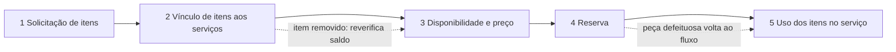

Em uma frase: a OS pede itens, o estoque vincula e verifica a disponibilidade, devolve o preço ao orçamento, e **só depois que o orçamento é aprovado** reserva os itens. Quando a OS avança (em execução, finalizada, entregue), o estoque dá baixa nos saldos. Se a OS é cancelada ou aparece uma peça defeituosa, existem trilhas próprias.

## 3. Fase 1: Solicitação de itens

A fase tem duas trilhas. A de cima começa com a OS pedindo itens; a de baixo é a entrada manual de itens no estoque. As duas se encontram no cadastro de item novo.

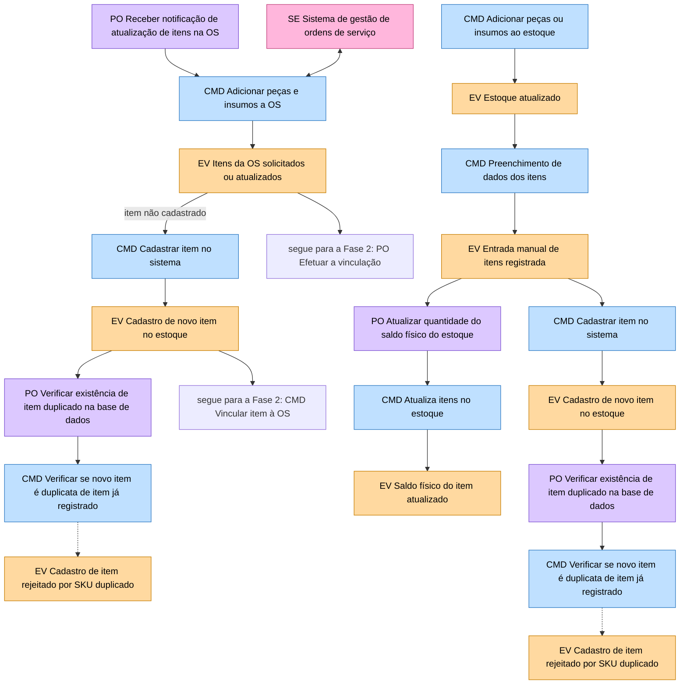

**Trilha de cima: a OS pede itens**

| # | Ator e modelo de leitura | Comando | Evento | Política associada | Sistema externo |
|---|---|---|---|---|---|
| 1 | (nenhum) | Adicionar peças e insumos a OS | Itens da OS solicitados ou atualizados | Antes: Receber notificação de atualização de itens na OS (gatilho que inicia o fluxo) | Sistema de gestão de ordens de serviço |
| 2 | Funcionário | Cadastrar item no sistema (quando o item pedido ainda não existe) | Cadastro de novo item no estoque | Depois: Verificar existência de item duplicado na base de dados | n/a |
| 3 | n/a | Verificar se novo item é duplicata de item já registrado | (exceção) Cadastro de item rejeitado por SKU duplicado | n/a | n/a |

**Trilha de baixo: entrada manual no estoque**

| # | Ator e modelo de leitura | Comando | Evento | Política associada | Sistema externo |
|---|---|---|---|---|---|
| 4 | Funcionário; ML Lista de itens do estoque | Adicionar peças ou insumos ao estoque | Estoque atualizado | n/a | n/a |
| 5 | Funcionário | Preenchimento de dados dos itens | Entrada manual de itens registrada | n/a | n/a |
| 6 | n/a | Atualiza itens no estoque | Saldo físico do item atualizado | Antes: Atualizar quantidade do saldo físico do estoque | n/a |
| 7 | Funcionário | Cadastrar item no sistema | Cadastro de novo item no estoque | Depois: Verificar existência de item duplicado na base de dados | n/a |
| 8 | n/a | Verificar se novo item é duplicata de item já registrado | (exceção) Cadastro de item rejeitado por SKU duplicado | n/a | n/a |

Os passos 7 e 8 repetem os passos 2 e 3: o mesmo cadastro de item novo é alcançado tanto pelo pedido da OS quanto pela entrada manual. **Os dois eventos "Cadastro de item rejeitado por SKU duplicado" são pontos finais**: nada acontece depois deles.

## 4. Fase 2: Vínculo de itens aos serviços

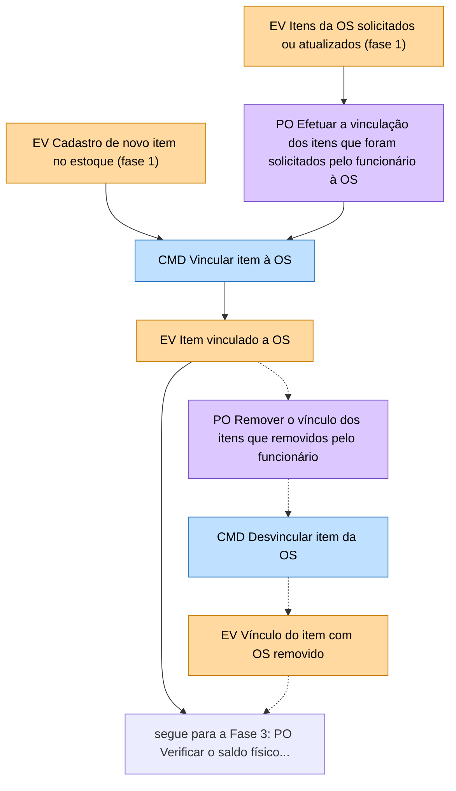

| # | Ator e modelo de leitura | Comando | Evento | Política associada | Sistema externo |
|---|---|---|---|---|---|
| 1 | n/a | Vincular item à OS | Item vinculado a OS | Antes: Efetuar a vinculação dos itens que foram solicitados pelo funcionário à OS | n/a |
| 2 | n/a | (desvio) Desvincular item da OS | (desvio) Vínculo do item com OS removido | Antes: Remover o vínculo dos itens que foram removidos pelo funcionário | n/a |

O evento "Item vinculado a OS" também dispara a verificação de saldo da fase 3. O evento "Vínculo do item com OS removido" volta, em seta vermelha tracejada, para a mesma verificação de saldo da fase 3: depois de remover um item, a disponibilidade é calculada de novo.

## 5. Fase 3: Disponibilidade e preço

Esta é a fase mais densa. Ela tem uma linha principal (verificar saldo e devolver o preço) e três desvios em vermelho: **item indisponível**, **item fora de linha** e **insumo comprometido**.

**5.1 Caminho principal**

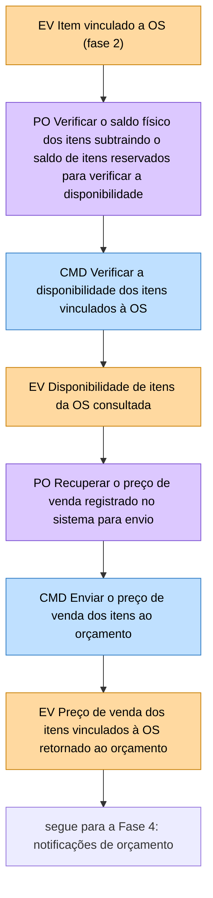

| # | Ator e modelo de leitura | Comando | Evento | Política associada | Sistema externo |
|---|---|---|---|---|---|
| 1 | n/a | Verificar a disponibilidade dos itens vinculados à OS | Disponibilidade de itens da OS consultada | Antes: Verificar o saldo físico dos itens subtraindo o saldo de itens reservados para verificar a disponibilidade | n/a |
| 2 | n/a | Enviar o preço de venda dos itens ao orçamento | Preço de venda dos itens vinculados à OS retornado ao orçamento | Antes: Recuperar o preço de venda registrado no sistema para envio | n/a |

A disponibilidade é **saldo físico menos saldo reservado**. O preço usado é o preço de venda registrado no sistema.

**5.2 Desvio A: item indisponível (cotação com fornecedores)**

Sai do evento "Disponibilidade de itens da OS consultada" em seta vermelha tracejada.

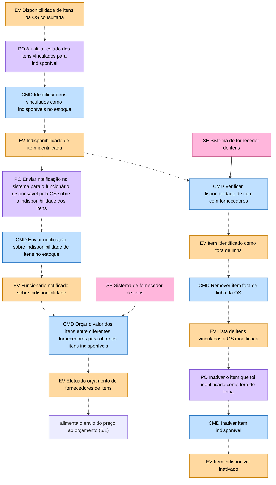

| # | Ator e modelo de leitura | Comando | Evento | Política associada | Sistema externo |
|---|---|---|---|---|---|
| 1 | n/a | Identificar itens vinculados como indisponíveis no estoque | Indisponibilidade de item identificada | Antes: Atualizar estado dos itens vinculados para indisponível | n/a |
| 2 | n/a | Enviar notificação sobre indisponibilidade de itens no estoque | Funcionário notificado sobre indisponibilidade | Antes: Enviar notificação no sistema para o funcionário responsável pela OS sobre a indisponibilidade dos itens | n/a |
| 3 | Funcionário; ML Lista de itens indisponíveis | Orçar o valor dos itens entre diferentes fornecedores para obter os itens indisponíveis | Efetuado orçamento de fornecedores de itens | n/a | Sistema de fornecedor de itens |
| 4 | Funcionário; ML Lista de itens indisponíveis | Verificar disponibilidade de item com fornecedores | Item identificado como fora de linha | n/a | Sistema de fornecedor de itens |
| 5 | Funcionário; ML Lista de itens indisponíveis | Remover item fora de linha da OS | Lista de itens vinculados a OS modificada | n/a | n/a |
| 6 | n/a | Inativar item indisponível | Item indisponivel inativado | Antes: Inativar o item que foi identificado como fora de linha | n/a |

Leitura do desvio: quando falta item, o sistema o marca como indisponível, avisa o funcionário e abre duas frentes: cotar com fornecedores (passo 3, cujo resultado volta para o cálculo do preço) e descobrir se o item saiu de linha (passos 4 a 6: se saiu, é removido da OS e inativado no cadastro).

**5.3 Desvio B: insumo comprometido (integridade física e validade)**

Sai do mesmo evento "Disponibilidade de itens da OS consultada" por uma seta vermelha tracejada que desce até a trilha de baixo.

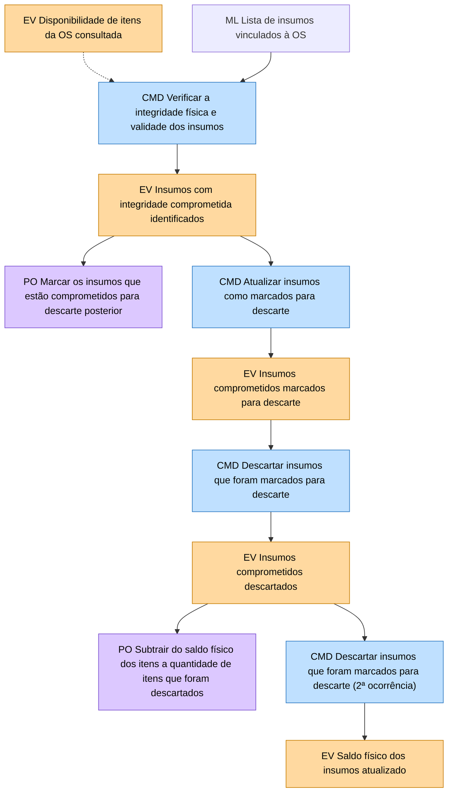

| # | Ator e modelo de leitura | Comando | Evento | Política associada | Sistema externo |
|---|---|---|---|---|---|
| 1 | Funcionário; ML Lista de insumos vinculados à OS | Verificar a integridade física e validade dos insumos | Insumos com integridade comprometida identificados | Depois: Marcar os insumos que estão comprometidos para descarte posterior | n/a |
| 2 | n/a | Atualizar insumos como marcados para descarte | Insumos comprometidos marcados para descarte | n/a | n/a |
| 3 | Funcionário; ML Lista de insumos marcados para descarte | Descartar insumos que foram marcados para descarte | Insumos comprometidos descartados | Depois: Subtrair do saldo físico dos itens a quantidade de itens que foram descartados | n/a |
| 4 | n/a | Descartar insumos que foram marcados para descarte | Saldo físico dos insumos atualizado | n/a | n/a |

## 6. Fase 4: Reserva

A fase começa quando o **orçamento recebe o preço** (fim da fase 3). A OS notifica o estoque da decisão do cliente: aprovado parcialmente, rejeitado ou aprovado. Só a aprovação leva à reserva.

**6.1 Decisão sobre o orçamento**

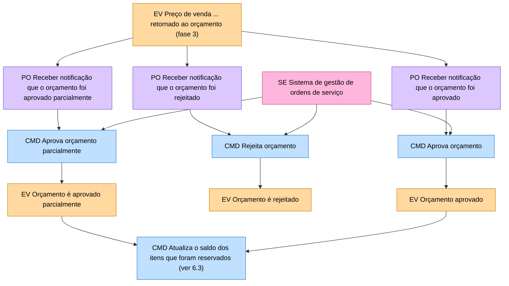

| # | Ator e modelo de leitura | Comando | Evento | Política associada | Sistema externo |
|---|---|---|---|---|---|
| 1 | n/a | Aprova orçamento parcialmente | Orçamento é aprovado parcialmente | Antes: Receber notificação que o orçamento foi aprovado parcialmente | Sistema de gestão de ordens de serviço |
| 2 | n/a | Rejeita orçamento | Orçamento é rejeitado | Antes: Receber notificação que o orçamento foi rejeitado | Sistema de gestão de ordens de serviço |
| 3 | n/a | Aprova orçamento | Orçamento aprovado | Antes: Receber notificação que o orçamento foi aprovado | Sistema de gestão de ordens de serviço |

Os eventos "Orçamento é aprovado parcialmente" e "Orçamento aprovado" seguem para a atualização do saldo reservado (6.3). "Orçamento é rejeitado" **não tem nenhuma continuação** no fluxo.

**6.2 Item em falta depois da aprovação: pedido ao fornecedor**

A partir de "Orçamento aprovado" o fluxo repete a verificação de disponibilidade. Se faltar item, abre-se uma trilha de compra com o fornecedor.

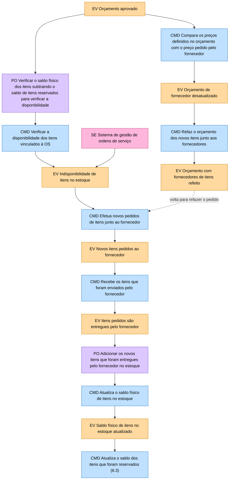

| # | Ator e modelo de leitura | Comando | Evento | Política associada | Sistema externo |
|---|---|---|---|---|---|
| 1 | n/a | Verificar a disponibilidade dos itens vinculados à OS | Indisponibilidade de itens no estoque | Antes: Verificar o saldo físico dos itens subtraindo o saldo de itens reservados para verificar a disponibilidade | Sistema de gestão de ordens de serviço |
| 2 | Funcionário; ML Lista de itens que constam no orçamento do fornecedor | Efetua novos pedidos de itens junto ao fornecedor | Novos itens pedidos ao fornecedor | n/a | Sistema de fornecedor de itens |
| 3 | Funcionário | Recebe os itens que foram enviados pelo fornecedor | Itens pedidos são entregues pelo fornecedor | n/a | n/a |
| 4 | n/a | Atualiza o saldo físico de itens no estoque | Saldo físico de itens no estoque atualizado | Antes: Adicionar os novos itens que foram entregues pelo fornecedor no estoque | n/a |
| 5 | Funcionário; ML Lista de itens que constam no orçamento do fornecedor | Compara os preços definidos no orçamento com o preço pedido pelo fornecedor | Orçamento de fornecedor desatualizado | n/a | Sistema de fornecedor de itens |
| 6 | Funcionário; ML Lista de itens que constam no orçamento do fornecedor | Refaz o orçamento dos novos itens junto aos fornecedores | (exceção, seta vermelha de volta ao passo 2) Orçamento com fornecedores de itens refeito | n/a | n/a |

Este é um **laço**: se o preço do fornecedor mudou em relação ao orçamento, o orçamento é refeito e o pedido volta a ser feito. Depois da entrega (passo 4), o saldo físico atualizado desemboca na reserva.

**6.3 Reserva dos itens**

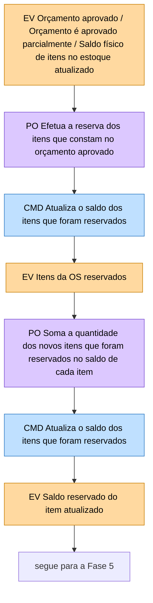

| # | Ator e modelo de leitura | Comando | Evento | Política associada | Sistema externo |
|---|---|---|---|---|---|
| 1 | n/a | Atualiza o saldo dos itens que foram reservados | Itens da OS reservados | Antes: Efetua a reserva dos itens que constam no orçamento aprovado | n/a |
| 2 | n/a | Atualiza o saldo dos itens que foram reservados | Saldo reservado do item atualizado | Antes: Soma a quantidade dos novos itens que foram reservados no saldo de cada item | n/a |

Os dois comandos atualizam a reserva. O primeiro registra a reserva dos itens da OS; o segundo, pela política que o precede, soma a quantidade reservada ao saldo reservado de cada item.

## 7. Fase 5: Uso dos itens no serviço

A fase acompanha as mudanças de status da OS, todas recebidas como notificação do sistema de gestão de ordens de serviço. Há uma linha principal no meio, uma trilha de **cancelamento** em cima e uma trilha de **peça defeituosa** embaixo.

**7.1 Caminho principal: execução, finalização e entrega**

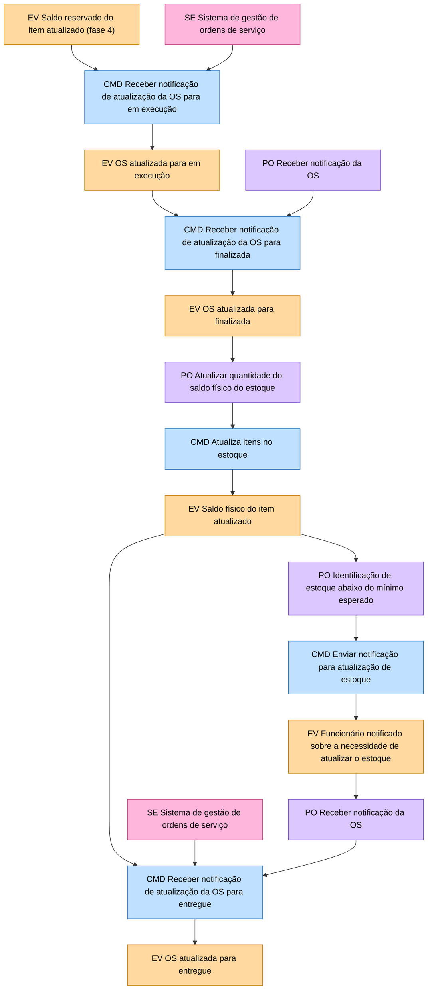

| # | Ator e modelo de leitura | Comando | Evento | Política associada | Sistema externo |
|---|---|---|---|---|---|
| 1 | n/a | Receber notificação de atualização da OS para "em execução" | OS atualizada para "em execução" | n/a | Sistema de gestão de ordens de serviço |
| 2 | n/a | Receber notificação de atualização da OS para "finalizada" | OS atualizada para "finalizada" | Antes: Receber notificação da OS | Sistema de gestão de ordens de serviço |
| 3 | n/a | Atualiza itens no estoque | Saldo físico do item atualizado | Antes: Atualizar quantidade do saldo físico do estoque (baixa dos itens consumidos) | n/a |
| 4 | n/a | Enviar notificação para atualização de estoque | Funcionário notificado sobre a necessidade de atualizar o estoque | Antes: Identificação de estoque abaixo do mínimo esperado | n/a |
| 5 | n/a | Receber notificação de atualização da OS para "entregue" | OS atualizada para "entregue" | Antes: Receber notificação da OS | Sistema de gestão de ordens de serviço |

A baixa do estoque acontece **quando a OS é finalizada**, não quando o serviço começa. Depois da baixa, se o saldo ficou abaixo do mínimo, o funcionário é notificado. A OS "entregue" é o último evento do caminho principal.

**7.2 Desvio: OS cancelada**

Sai de "OS atualizada para finalizada" por uma seta vermelha tracejada que sobe até a trilha de cima.

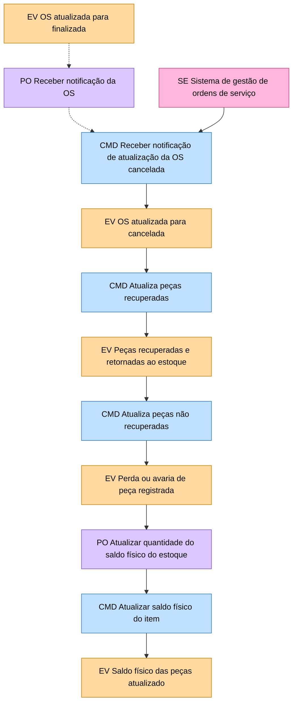

| # | Ator e modelo de leitura | Comando | Evento | Política associada | Sistema externo |
|---|---|---|---|---|---|
| 1 | n/a | Receber notificação de atualização da OS para "cancelada" | OS atualizada para "cancelada" | Antes: Receber notificação da OS | Sistema de gestão de ordens de serviço |
| 2 | Funcionário; ML Lista de peças vinculadas à OS | Atualiza peças recuperadas | Peças recuperadas e retornadas ao estoque | n/a | n/a |
| 3 | Funcionário; ML Lista de peças vinculadas à OS | Atualiza peças não recuperadas | Perda ou avaria de peça registrada | n/a | n/a |
| 4 | n/a | Atualizar saldo físico do item | Saldo físico das peças atualizado | Antes: Atualizar quantidade do saldo físico do estoque | n/a |

No cancelamento, as peças vinculadas são separadas em recuperadas (voltam ao estoque) e não recuperadas (registradas como perda ou avaria), e o saldo físico é ajustado. Isso é coerente com o fluxo da OS, onde "finalizada" volta para "cancelada" quando o pagamento vence.

**7.3 Desvio: peça defeituosa e garantia**

Começa no evento "OS atualizada para em execução" (seta vermelha curta para baixo) e termina com uma seta vermelha longa que volta ao caminho principal.

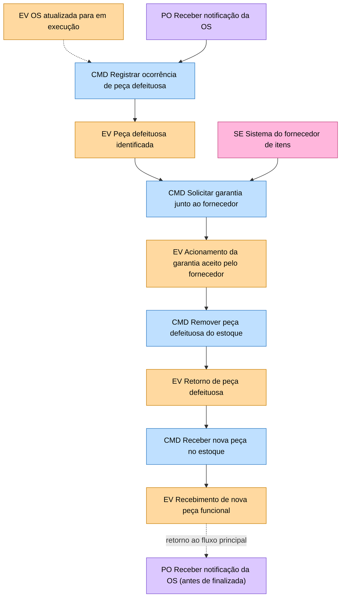

| # | Ator e modelo de leitura | Comando | Evento | Política associada | Sistema externo |
|---|---|---|---|---|---|
| 1 | Funcionário | Registrar ocorrência de peça defeituosa | Peça defeituosa identificada | Antes: Receber notificação da OS | n/a |
| 2 | Funcionário | Solicitar garantia junto ao fornecedor | Acionamento da garantia aceito pelo fornecedor | n/a | Sistema do fornecedor de itens |
| 3 | Funcionário; ML Lista de peças do estoque | Remover peça defeituosa do estoque | Retorno de peça defeituosa | n/a | n/a |
| 4 | Funcionário | Receber nova peça no estoque | Recebimento de nova peça funcional | n/a (a seta vermelha longa leva este evento de volta ao caminho principal) | n/a |

O fluxo é: a peça com defeito é registrada, a garantia é pedida ao fornecedor, a peça ruim sai do estoque, a nova chega ao estoque. Depois disso, o fluxo retorna ao ponto do caminho principal anterior à finalização da OS. O fluxo só mostra a garantia **aceita** pelo fornecedor; não há caminho para garantia recusada.

## 8. Agregados

O caminho principal agrupado em duas colunas do agregado ITEM. As exceções não entram nesta visão.

**ITEM (coluna principal, 12 linhas, de cima para baixo)**

| # | Comando | Evento | Política ou observação |
|---|---|---|---|
| 0 | (linha de entrada) | n/a | Receber notificação de atualização de itens na OS. SE Sistema de gestão de ordens de serviço |
| 1 | Adicionar itens a OS | Itens da OS solicitados ou atualizados | Efetuar a vinculação dos itens que foram solicitados pelo funcionário à OS |
| 2 | Vincular item à OS | Item vinculado a OS | Verificar o saldo físico dos itens subtraindo o saldo de itens reservados para verificar a disponibilidade |
| 3 | Verificar a disponibilidade dos itens vinculados à OS | Disponibilidade de itens da OS consultada | Recuperar o preço de venda registrado no sistema para envio |
| 4 | Enviar o preço de venda dos itens ao orçamento | Preço de venda dos itens vinculados à OS retornado ao orçamento | Receber notificação que o orçamento foi aprovado. SE Sistema de gestão de ordens de serviço |
| 5 | Aprova orçamento | Orçamento aprovado | Efetua a reserva dos itens que constam no orçamento aprovado |
| 6 | Atualiza o saldo reservado dos itens que foram reservados | Itens da OS reservados | Soma a quantidade dos novos itens que foram reservados no saldo reservado de cada item |
| 7 | Atualiza o saldo reservado dos itens que foram reservados | Saldo reservado do item atualizado | Receber notificação da OS. SE Sistema de gestão de ordens de serviço |
| 8 | Receber notificação de atualização da OS para "em execução" | OS atualizada para "em execução" | Receber notificação da OS |
| 9 | Receber notificação de atualização da OS para "finalizada" | OS atualizada para "finalizada" | Atualizar quantidade do saldo físico do estoque |
| 10 | Atualiza itens no estoque | Saldo físico do item atualizado | Receber notificação da OS. SE Sistema de gestão de ordens de serviço |
| 11 | Receber notificação de atualização da OS para "entregue" | OS atualizada para "entregue" | n/a |

**ITEM (segunda coluna, menor: entrada manual de estoque)**

Traz o ML Lista de itens do estoque e o ator Funcionário.

| Comando | Evento | Política ou observação |
|---|---|---|
| Adicionar itens ao estoque (Funcionário; ML Lista de itens do estoque) | Estoque atualizado | n/a |
| Preenchimento de dados dos itens (Funcionário) | Entrada manual de itens registrada | Atualizar quantidade do saldo físico do estoque |
| Atualiza itens no estoque | Saldo físico do item atualizado | n/a |

Esta coluna corresponde à entrada manual de estoque da fase 1.

## 9. Contexto

Um único contexto delimitado contém as duas colunas ITEM. O Sistema de gestão de ordens de serviço fica fora da fronteira e conversa com o estoque por notificações.

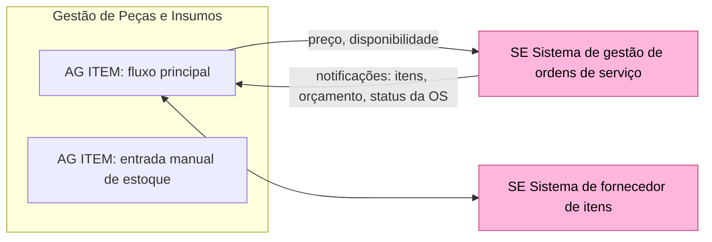

| Elemento | Conteúdo |
|---|---|
| Contexto | Gestão de Peças e Insumos, com as duas colunas ITEM |
| Sistemas externos na fronteira | Sistema de gestão de ordens de serviço; Sistema de fornecedor de itens |

## 10. Relação com o fluxo da OS

Os dois fluxos descrevem o mesmo domínio por lados diferentes. O fluxo da OS (`fluxo-os.md`) chama o estoque de "Sistema de estoque de itens" e "Sistema de gestão de peças e insumos". Este fluxo chama a OS de "Sistema de gestão de ordens de serviço". A tabela liga as duas pontas.

| Momento | No fluxo da OS | No fluxo de estoque |
|---|---|---|
| Itens pedidos | Adiciona serviços, peças e insumos à OS (SE Sistema de estoque de itens) | PO Receber notificação de atualização de itens na OS, CMD Adicionar peças e insumos a OS |
| Disponibilidade e preço | Cálculo do orçamento (somatório do valor padrão dos serviços e dos valores de peças e insumos) | Verificar a disponibilidade, enviar o preço de venda ao orçamento |
| Decisão do cliente | Aprova, aprova parcialmente ou rejeita o orçamento | PO Receber notificação que o orçamento foi aprovado, aprovado parcialmente ou rejeitado |
| Serviço em execução, finalizada, entregue | Status da OS: em execução, finalizada, entregue | CMD Receber notificação de atualização da OS para cada status |
| Cancelamento por inadimplência | Desfaz o serviço e peças retornadas ao estoque (SE Sistema de gestão de peças e insumos) | Trilha de OS cancelada: peças recuperadas e não recuperadas |
| Problema no veículo | Volta para "em diagnóstico" | Registrar ocorrência de peça defeituosa e acionar garantia |
