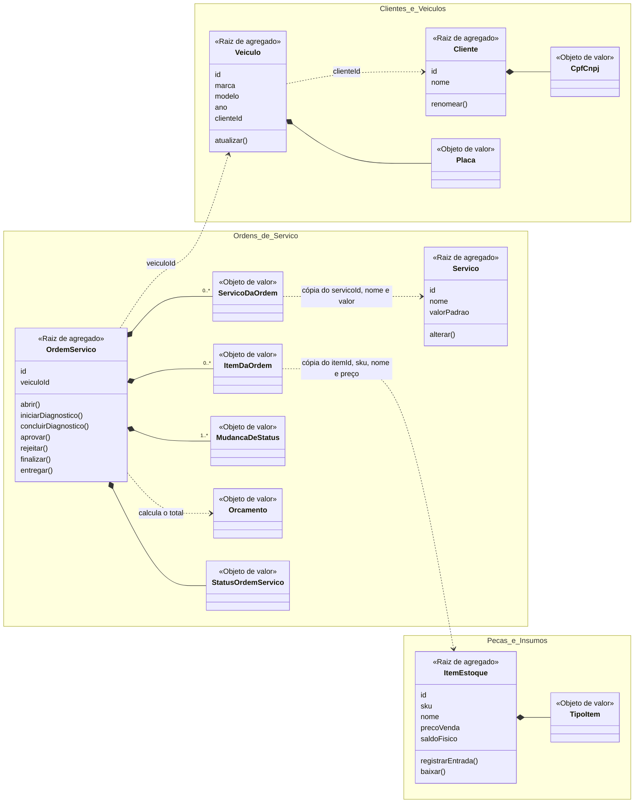

# Modelo de domínio: agregados, entidades e objetos de valor

Este documento liga o DDD ao código. Para cada contexto delimitado, ele lista os agregados, as entidades e os objetos de valor implementados, com a regra que cada um protege e a classe correspondente em `src/main/java/br/com/fiap/oficina/domain/`. Os termos seguem a [linguagem ubíqua](linguagem-ubiqua.md), e os comandos e eventos que mudam cada agregado estão nos fluxos de [Event Storming da OS](event-storming/fluxo-os.md) e de [peças e insumos](event-storming/fluxo-pecas-insumos.md).

## Critérios de classificação

| Tipo | Critério usado no projeto | Como aparece no código |
| --- | --- | --- |
| **Agregado** | Fronteira de consistência: tudo o que muda junto numa transação, com uma regra que precisa valer ao final. Outros agregados o referenciam só pelo id. | Um repositório por agregado (`*Repository` no domínio). |
| **Raiz do agregado** | A única entidade do agregado acessível de fora; todo comando passa por ela, que valida a regra. | Classe com `id` e métodos de negócio (`aprovar`, `baixar`, `renomear`). |
| **Entidade** | Tem identidade própria que persiste enquanto o estado muda. | Classe com `id`, atributos mutáveis e igualdade por identidade. |
| **Objeto de valor** | Definido só pelos seus atributos, imutável e trocado inteiro quando muda. Valida a si mesmo na criação. | `record` Java, com a validação no construtor; enums para conjuntos fechados. |

## Visão geral

Linha cheia (`*--`) indica composição dentro do agregado. A linha tracejada (`..>`) indica referência a outro agregado por id ou por cópia de dados, nunca por objeto.

## Gestão de Clientes e Veículos (`domain/cliente`)

| Tipo | Elemento | Responsabilidade e regras | Código |
| --- | --- | --- | --- |
| Raiz de agregado | **Cliente** | Proprietário do veículo, identificado pelo CPF/CNPJ, que não muda depois do cadastro. Nome obrigatório (`NOME_OBRIGATORIO`). Só é removido sem veículos (`CLIENTE_COM_VEICULOS`). | [`Cliente`](../../src/main/java/br/com/fiap/oficina/domain/cliente/Cliente.java), [`ClienteRepository`](../../src/main/java/br/com/fiap/oficina/domain/cliente/ClienteRepository.java) |
| Raiz de agregado | **Veículo** | Objeto de trabalho da oficina, identificado pela placa e vinculado a um cliente pelo `clienteId`. Marca e modelo obrigatórios; ano entre 1900 e o ano seguinte ao atual (`ANO_VEICULO_INVALIDO`). Placa e dono não mudam. | [`Veiculo`](../../src/main/java/br/com/fiap/oficina/domain/cliente/Veiculo.java), [`VeiculoRepository`](../../src/main/java/br/com/fiap/oficina/domain/cliente/VeiculoRepository.java) |
| Objeto de valor | **CPF/CNPJ** | Documento do cliente. Valida os dígitos verificadores do CPF e do CNPJ, inclusive o CNPJ alfanumérico, e normaliza sem máscara e em maiúsculas (`CPF_CNPJ_INVALIDO`). | [`CpfCnpj`](../../src/main/java/br/com/fiap/oficina/domain/cliente/CpfCnpj.java) |
| Objeto de valor | **Placa** | Placa no padrão antigo (`ABC1234`) ou Mercosul (`ABC1D23`), normalizada sem hífen e em maiúsculas (`PLACA_INVALIDA`). | [`Placa`](../../src/main/java/br/com/fiap/oficina/domain/cliente/Placa.java) |

## Gestão de Ordens de Serviço (`domain/ordemservico`)

| Tipo | Elemento | Responsabilidade e regras | Código |
| --- | --- | --- | --- |
| Raiz de agregado | **Ordem de Serviço (OS)** | Agrupa o diagnóstico, os serviços, as peças e insumos, o orçamento e o histórico de status do veículo de um cliente. Toda mudança de status passa por um método de negócio que valida a transição (`TRANSICAO_INVALIDA`). Serviços e itens só mudam em `EM_DIAGNOSTICO` (`ORDEM_FORA_DE_DIAGNOSTICO`), e o orçamento exige ao menos um serviço (`ORDEM_SEM_SERVICO`). | [`OrdemServico`](../../src/main/java/br/com/fiap/oficina/domain/ordemservico/OrdemServico.java), [`OrdemServicoRepository`](../../src/main/java/br/com/fiap/oficina/domain/ordemservico/OrdemServicoRepository.java) |
| Raiz de agregado | **Serviço** (catálogo) | Serviço oferecido pela oficina, com nome único e valor padrão (mão de obra) maior que zero (`VALOR_PADRAO_INVALIDO`). | [`Servico`](../../src/main/java/br/com/fiap/oficina/domain/ordemservico/Servico.java), [`ServicoRepository`](../../src/main/java/br/com/fiap/oficina/domain/ordemservico/ServicoRepository.java) |
| Objeto de valor | **Status da OS** | Os sete status e as transições permitidas entre eles: Recebida → Em diagnóstico → Aguardando aprovação → Em execução → Finalizada → Entregue, ou Cancelada a partir de Aguardando aprovação. | [`StatusOrdemServico`](../../src/main/java/br/com/fiap/oficina/domain/ordemservico/StatusOrdemServico.java) |
| Objeto de valor | **Serviço da OS** | Cópia do serviço do catálogo no momento da inclusão (id, nome e valor). Mudar o catálogo depois não altera a OS. | [`ServicoDaOrdem`](../../src/main/java/br/com/fiap/oficina/domain/ordemservico/ServicoDaOrdem.java) |
| Objeto de valor | **Item da OS** | Peça ou insumo incluído na OS, com quantidade e preço unitário cotado. Incluir de novo o mesmo item gera um novo valor com a quantidade somada. | [`ItemDaOrdem`](../../src/main/java/br/com/fiap/oficina/domain/ordemservico/ItemDaOrdem.java) |
| Objeto de valor | **Orçamento** | Total da OS: soma dos valores dos serviços e de quantidade × preço dos itens. É calculado ao concluir o diagnóstico. | [`Orcamento`](../../src/main/java/br/com/fiap/oficina/domain/ordemservico/Orcamento.java) |
| Objeto de valor | **Mudança de status** | Registro de um status com data e hora. A sequência forma o histórico que o cliente acompanha e que dá o tempo de execução (AD-005). | [`MudancaDeStatus`](../../src/main/java/br/com/fiap/oficina/domain/ordemservico/MudancaDeStatus.java) |
| Objeto de valor | **Veículo identificado** | Resposta do contexto de Clientes ao abrir a OS: id do veículo, CPF/CNPJ e placa já validados e normalizados. | [`VeiculoIdentificado`](../../src/main/java/br/com/fiap/oficina/domain/ordemservico/VeiculoIdentificado.java) |
| Objeto de valor | **Item cotado** | Resposta do contexto de Estoque ao incluir uma peça ou insumo: id, SKU, nome e preço de venda atual. | [`ItemCotado`](../../src/main/java/br/com/fiap/oficina/domain/ordemservico/ItemCotado.java) |
| Porta | **Cadastro de veículos** | Interface que a OS declara para identificar cliente e veículo sem depender do contexto de Clientes. | [`CadastroDeVeiculos`](../../src/main/java/br/com/fiap/oficina/domain/ordemservico/CadastroDeVeiculos.java) |
| Porta | **Estoque de itens** | Interface que a OS declara para cotar itens e dar baixa no estoque na aprovação. | [`EstoqueDeItens`](../../src/main/java/br/com/fiap/oficina/domain/ordemservico/EstoqueDeItens.java) |

## Gestão de Peças e Insumos (`domain/estoque`)

| Tipo | Elemento | Responsabilidade e regras | Código |
| --- | --- | --- | --- |
| Raiz de agregado | **Item de estoque** | Peça ou insumo com SKU único, preço de venda maior que zero e saldo físico. O saldo muda só por entrada (`registrarEntrada`) e baixa (`baixar`) e nunca fica negativo (`SALDO_INSUFICIENTE`). | [`ItemEstoque`](../../src/main/java/br/com/fiap/oficina/domain/estoque/ItemEstoque.java), [`ItemEstoqueRepository`](../../src/main/java/br/com/fiap/oficina/domain/estoque/ItemEstoqueRepository.java) |
| Objeto de valor | **Tipo do item** | Peça ou insumo. | [`TipoItem`](../../src/main/java/br/com/fiap/oficina/domain/estoque/TipoItem.java) |

## Decisões de modelagem

- **Veículo é um agregado separado do Cliente.** O veículo é cadastrado, alterado e removido sem mexer no cliente, e nenhuma regra do cliente depende da lista de veículos dele. A única regra entre os dois (cliente com veículos não é removido) é verificada pelo caso de uso `RemoverCliente`, que consulta o `VeiculoRepository`. Com o veículo dentro do cliente, alterar um carro bloquearia o cadastro inteiro do dono.
- **Serviço do catálogo é um agregado separado da OS.** O catálogo muda no próprio ritmo, e a OS não pode mudar junto. Por isso a OS guarda uma cópia (`ServicoDaOrdem`) do nome e do valor do momento da inclusão. Com o item de estoque é igual: `ItemDaOrdem` guarda o preço cotado.
- **Itens e serviços da OS são objetos de valor, não entidades.** Eles não têm ciclo de vida fora da OS e são identificados pelo id do serviço ou item de origem. Toda alteração (somar quantidade, remover) troca o valor inteiro dentro da raiz.
- **A OS guarda CPF/CNPJ e placa como texto.** `CpfCnpj` e `Placa` pertencem ao contexto de Clientes, e o domínio da OS não depende dele (regra verificada pelo `ArquiteturaTest`). A validação acontece na fronteira: a porta `CadastroDeVeiculos` devolve um `VeiculoIdentificado` já normalizado, que a OS copia.
- **Orçamento é um valor calculado, não uma entidade.** Sem renegociação no MVP, não há histórico de orçamentos com identidade própria. A OS guarda só o total resultante.

## Mapeados no Event Storming e fora do MVP

Os elementos abaixo aparecem nos fluxos de Event Storming, mas não têm código no MVP (AD-003 e AD-004 em [`.specs/STATE.md`](../../.specs/STATE.md)):

| Elemento | Contexto | Motivo |
| --- | --- | --- |
| Pagamento e Nota Fiscal (agregados) | Cobrança e Faturamento | Cobrança fora do escopo obrigatório. O pacote `cobranca` está reservado. |
| Reserva e saldo reservado | Peças e Insumos | A aprovação baixa o saldo físico direto, tudo ou nada (AD-004). |
| Histórico de orçamentos, prazo e estoque mínimo | OS e Estoque | Trilhas de exceção sem requisito obrigatório correspondente. |
